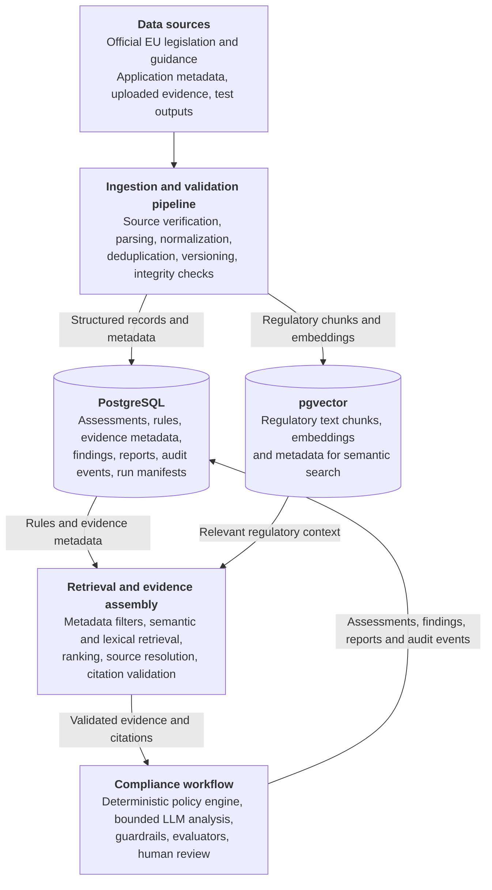
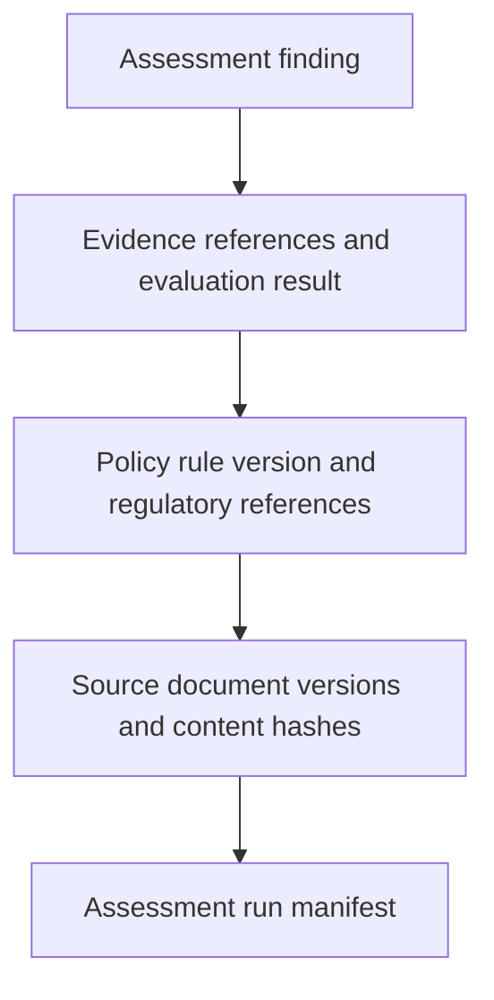
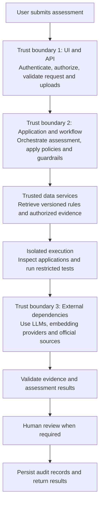
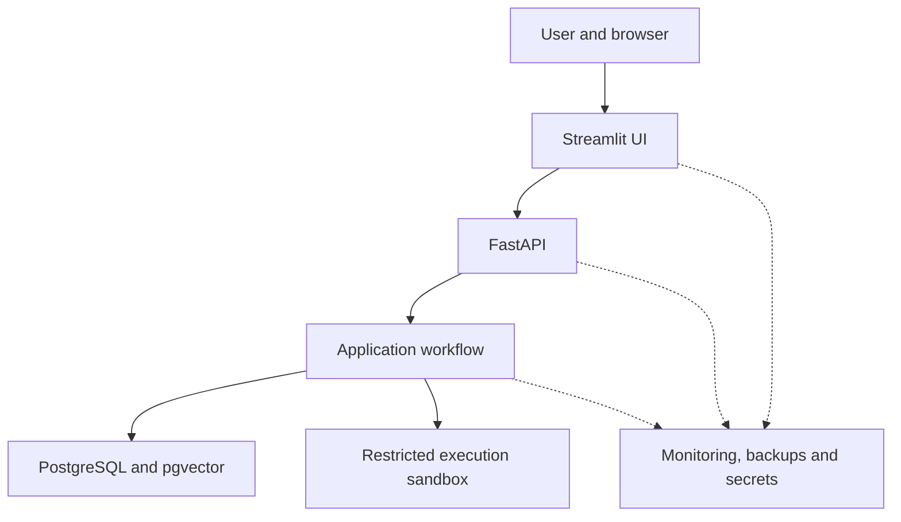
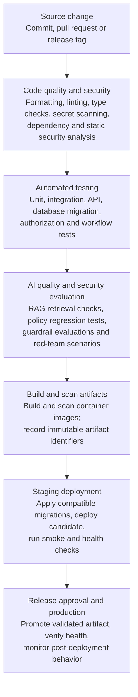

# Executive Summary

## Purpose

The EU AI Act Guardrail & Compliance Sandbox is an open-source, modular platform designed to evaluate AI applications against relevant requirements of the European Union Artificial Intelligence Act (EU AI Act) before they are deployed into production.
As organisations increasingly adopt Large Language Models (LLMs), RAGs and Agentic AI systems, they need systematic ways to :
- identify regulatory risks
- validate safety controls
- evaluate transparency requirements
- maintain evidence of their compliance assessments.
The sandbox addresses this requirement by providing an automated, evidence driven evaluation pipeline that combines deterministic compliance rules, AI-assisted analysis, automated evaluators,guardrails and adverserial testing.  

## Key Capabilities

The platform is designed to support the following capabilities:

1. Risk classification - Assess AI systems against relevant risk categories, including prohibited practices and high risk categories.
2. Regulatory control evaluation - Evaluate applicable requirements associated with the below articles:
    - Article 5 - outlaws 8 categories of AI Usage such as
        - Subliminal manipulation - AI that uses hidden techniques outside a person's conscious awareness to alter their behavior.
        - Vulnerability exploitation - AI that exploits a person’s age, disability, or specific social/economic situation to distort their behavior and cause harm.
        - Social scoring systems - AI used by governments or private companies to grade people based on their daily social behavior, leading to unfair or unrelated penalties.
        - Biometric categorization to infer sensitive personal traits - AI that analyzes physical characteristics to deduce protected personal traits like race, religion, or sexual orientation.
        - Real-Time Public Biometric Identification -  Using live facial recognition in public spaces for law enforcement tracking.
        - Emotion Recognition in Workplace and Schools - AI that attempts to detect a person's emotional state in professional or educational environments.
        - Untargeted Facial Scraping - Creating or expanding facial recognition databases by mass-harvesting images from the internet or CCTV footage.
        - Predictive Policing for Individuals - AI that predicts whether a specific individual will commit a crime based purely on profiling or past behavior, without hard evidence.
        - Non-Consensual Deepfake Intimate Images - AI used to create, modify, or distribute sexually explicit images or videos of a person without their consent.
        - AI-Generated Child Abuse Material - AI used to generate, facilitate, or expand the reach of child sexual abuse material.
    - Article 6 - lists classification rules to group them into a high risk category if any app has these:
        - Regulated Product Safety - AI systems built into physical products that already require independent, third-party safety certifications under existing EU laws.
        - Standalone High-Risk Software 
            - Biometrics (Allowed Uses) - AI used for legal remote biometric identification, emotion recognition, or scanning traits (that aren't already banned under Article 5).
            - Critical Infrastructure - AI used to manage or operate vital safety systems for public utilities and transport.
            - Education and Vocational Training - AI used to determine access to school, rank students, or monitor them during exams.
            - Employment and Worker Management - AI used for recruiting, filtering applications, or monitoring and evaluating employees.
            - Essential Private and Public Services - AI used to evaluate if people qualify for life-changing financial or social benefits.
            - Law Enforcement (Allowed Uses) - AI tools used by police to assess evidence, evaluate polygraphs, or calculate recidivism risks.
            - Migration, Asylum, and Border Control - AI used to assist authorities in checking travel documents or assessing security risks of travelers.
            - Administration of Justice and Democracy - AI used by courts to research laws or systems intended to influence the outcome of an election.
    - Article 50 - this article looks at transparency rules. It specifies that all people have a right to know when they are dealing with AI and AI related content, and they should have the sole right to choose to use it or not. Rules are split between providers and deployers/AI users.
        - For providers: 
            - Disclosing Direct AI Interactions (Chatbots) which means, AI systems designed to talk to humans must explicitly warn the user that they are interacting with a machine, unless it is totally obvious to the user it is talking to a bot.
            - Watermarking and Content Tracking (Synthetic Media) which means, AI systems generating synthetic content should have an invisible, reliable, machine readable markings directly into their outputs so that the user is aware it is dealing with synthetic media.
        - For AI Users:
            - Labeling Deepfakes which means that if a business alters or generates realistic audio, video and image content that mimics real people, events or places, the content must be specifically labelled. An exception can be made if content is created for strictly artistic, creative, or satirical purposes, provided a basic, non-obtrusive disclosure is made.
            - Notifying People About Emotion and Biometric Tracking -  If a system uses allowed biometrics to categorize people or scan their emotions, the people exposed to it must be actively informed.
            - Labeling Public-Interest AI Text - If AI generates or heavily modifies news articles or public reports meant to inform the public on matters of general interest, it must be disclosed.
    - Article 51- General Purpose AI(GPAI) models need to comply with the below:
        - Systemic Risk Classification - Any AI model trained on a massive computational scale is automatically considered to have systemic risk.
        - The Notification Procedure - AI Builders need to step forward and alert the EU Commision if their model meets the high impact criteria.
        - Baseline Obligations for ALL GPAI Models - Any model which has been identified has systemic risk, will require the below to be done:
            - Maintain detailed report of training and testing data for the EU office
            - Provide clear instructions and documentation to any consumer using this model to build AI tools on top of this model.
            - Create a strict policy to honour EU copyright laws and respect creator data outputs.
            - Publish a clear public overview of the text, data, or media used to train the model
    - Article 54 -  If an AI provider is based outside the EU (such as in the US or Asia) but wants to make its model available to European users, it must legally appoint an Authorized Representative located within the EU to handle compliance requests and potential liability.
    - Article 55 - Extra Obligations for Systemic Risk Models
            -  Force continuous, aggressive hacking and stress-testing of the model to uncover hidden flaws.
            - Assess and continuously patch potential national security, economic, or societal risks.
            - Immediately alert the EU office if the model has caused a severe accident or malfunctioned.
            - Implement top tier digital security to lock down and protect the model's weights and architecture from data leaks or foreign thefts.
3. Evidence-backed assessments - Retrieve relevant regulatory provisions and link evaluation findings to their supporting evidence.
4. AI safety and guardrails - Test AI applications for policy violations, unsafe outputs, prompt injection, and other identified risks.
5. Automated evaluation and red teaming - Execute repeatable test suites to measure application behavior, robustness, and compliance-related control effectiveness.
6. Auditability and reproducibility- Record evaluation inputs, configuration versions, findings, evidence references, and decisions to support traceability and repeatable assessments.
7. Operational observability- Monitor evaluation performance, errors, guardrail violations, and other operational metrics.
8. Continuous integration- Integrate automated checks into development and deployment workflows to identify issues before release.

## Intended users

The platform is intended for AI engineers, ML engineers, solution architects, AI governance teams, security engineers, and compliance professionals who need to assess AI applications during development and before production deployment.

It provides technical evidence and structured findings to support human review and governance decisions.

## Design Principles

The architecture follows these principles:
1. Rules over unrestricted model judgment- Use deterministic rules for explicit regulatory conditions wherever feasible, with AI-assisted reasoning reserved for ambiguous or context-dependent assessments.
2. Evidence before conclusions- Every material finding should reference the applicable regulatory source, evaluation result, or other supporting evidence.
3. Separation of concerns- Keep orchestration, compliance logic, guardrails, evaluators, security, and audit logging as distinct components.
4. Human oversight- Route ambiguous, high-impact, or insufficiently supported findings for review rather than presenting uncertain results as definitive legal conclusions.
5. Reproducibility by design- Version test cases, evaluation configurations, regulatory sources, and relevant model or prompt configurations.
6. Open-source implementation- Prefer free and open-source software for development, testing, observability, and deployment.
7. Production-oriented engineering- Design for security, modularity, monitoring, testability, and controlled deployment from the beginning.

## Expected Outcomes

- The sandbox will demonstrate how an engineering team can build a structured AI governance workflow that combines regulatory mapping, automated testing, evidence retrieval, safety controls, and auditable decision-making.
- Its output will be an evidence-backed assessment report containing applicable controls, test results, identified risks, supporting evidence, unresolved questions, and recommended remediation actions.
- The platform is a technical assessment and governance-support tool. Its results do not, by themselves, establish legal compliance, replace professional legal advice, or constitute regulatory certification.

# Goals and Non-Goals

## Goals

- The primary goal of the EU AI Act Guardrail & Compliance Sandbox is to provide a modular, evidence-driven platform for assessing AI applications against selected requirements of the EU AI Act.
- The platform will combine deterministic compliance rules, AI-assisted analysis, regulatory evidence retrieval, automated evaluation, guardrails, adversarial testing, and auditable reporting.
- The following goals define the intended capabilities of the platform.
    - G1. Regulatory Applicability and Risk Classification: 
        Assess an AI application's intended purpose, deployment context, and relevant characteristics to identify potentially applicable EU AI Act requirements.
        The initial scope will cover:
        - Article 2 - Scope and applicability
        - Article 3 - Relevant definitions
        - Article 5 - Prohibited AI practices
        - Article 6 - together with Annex I and Annex III: High-risk classification pathways.
        - Article 50 - Applicable transparency obligations.
        - Article 51 to 55 - Relevant general-purpose AI model provisions.
        The system must distinguish between confirmed rule outcomes, preliminary classifications, insufficient information, and cases requiring human review.
    - G2. Modular Compliance Control Engine: 
        - Implement compliance checks as independently testable controls rather than embedding regulatory logic inside individual agents or prompts.
        - Each control should define its purpose, applicability conditions, evaluation logic, expected evidence, outcome, and relevant regulatory references.
        - The design must support adding or updating controls without requiring a redesign of the entire platform.
    - G3. Regulatory Evidence Retrieval
        - Provide a retrieval pipeline for official regulatory documents and other explicitly approved supporting sources
        - The pipeline will support document ingestion, metadata extraction, chunking, indexing, retrieval, and evidence traceability.
        - Retrieved evidence must retain its source reference and relevant regulatory location wherever available. The system must not treat a retrieved passage or an LLM-generated interpretation as definitive proof of compliance.
    - G4. AI Safety Guardrails
        - Implement reusable guardrails to test or constrain AI application behavior.
        - Initial technical checks may include input validation, prompt-injection resistance, unsafe output detection, sensitive-data handling, and restrictions on unauthorized tool or network access.
        - Guardrails must be evaluated against defined test cases, and their limitations and failure modes must be documented.
    - G5. Automated Evaluation and Adversarial Testing
        - Provide repeatable test suites for assessing AI application behavior and the effectiveness of implemented controls.
        - Evaluation capabilities will include expected-versus-observed behavior checks, regression tests, adversarial test cases, and configurable evaluation metrics.
        - The system must record test outcomes and supporting evidence so that findings can be investigated and compared across application or configuration versions.
    - G6. Explainable and Auditable Reporting
        - Generate structured assessment reports containing:
            - Application and evaluation identifiers.
            - Applicable controls and their regulatory references.
            - Evaluation results and supporting evidence.
            - Identified risks, limitations, and unresolved questions.
            - Failed checks and recommended remediation actions.
            - Relevant application, test-set, and configuration versions.
        The platform must maintain a traceable record of how assessment outcomes were produced.
    - G7. Security and Access Control
        - Apply secure engineering practices to the sandbox and its evaluation environment.
        - Controls will include input validation, secrets management, least-privilege access, appropriate authentication and authorization, safe handling of untrusted content, and protection against common application and infrastructure attacks.
        - Testing untrusted applications must be isolated from the compliance platform and its sensitive resources.
    - G8. Observability and Operational Metrics
        - Provide structured logs, application metrics, and distributed tracing where appropriate.
        - The platform should measure operational characteristics such as evaluation latency, error rates, guardrail failures, retrieval performance, and test execution outcomes.
        - Operational monitoring must distinguish infrastructure health from the quality or effectiveness of compliance controls.
    - G9. Reproducibility and Version Management
        - Record the versions of regulatory sources, control definitions, evaluation datasets, application builds, and relevant model and prompt configurations used during each assessment.
        - The platform should support rerunning evaluations under recorded conditions and comparing results across versions.
        - Because some AI models produce nondeterministic outputs, reproducibility means traceable evaluation conditions and comparable results, not a guarantee of identical output on every run.
    - G10. Continuous Integration and Deployment
        - Integrate automated unit tests, integration tests, evaluation suites, and security checks into the development pipeline.
        - Where configured, the pipeline should prevent deployment when defined blocking conditions are violated.
        - Compliance-related deployment decisions must use explicit policies and must not rely solely on an aggregate AI-generated score.
    - G11. Open-Source and Portable Deployment
        - Use free and open-source software components for the initial implementation wherever practical.
        - The platform should support local development and containerized deployment without requiring proprietary LLM APIs.
        - Models and infrastructure components should be replaceable through defined interfaces where feasible.
    - G12. Human Oversight
        - Support human review of ambiguous classifications, incomplete evidence, high-impact findings, and controls that cannot be reliably evaluated automatically.
        - The platform must communicate uncertainty and distinguish technical assessment results from legal determinations.
## Non-Goals
- The following items are explicitly outside the initial implementation scope.
    - NG1. Legal Advice or Certification
        - The platform will not provide authoritative legal advice, guarantee EU AI Act compliance, or issue legal certifications.
        - Its reports provide technical assessment results and supporting evidence for review by qualified legal, compliance, and domain professionals.
    - NG2. Complete Automation of Every Legal Obligation
        - The initial implementation will not attempt to automate every article, annex, exception, or obligation under the EU AI Act.
        - The regulatory scope will expand incrementally, with each implemented control documented and tested.
        - Unimplemented provisions must be identified as out of scope rather than implicitly treated as satisfied.
    - NG3. Replacement of Human Governance
        - The platform will not replace legal counsel, conformity assessment bodies, regulators, designated organizational decision-makers, or required human oversight.
        - Automated findings will support human decisions rather than eliminate them.
    - NG4. Guaranteed Detection of Every AI Safety Failure
        - The sandbox cannot guarantee the detection of every prohibited behavior, vulnerability, hallucination, prompt injection, or security weakness.
        - Evaluation coverage depends on the available test cases, evidence, application access, and effectiveness of the implemented controls.
    - NG5. Proprietary LLM Dependency
        - The initial platform will not require proprietary hosted LLM APIs as a mandatory runtime dependency.
        - Local models and open-source tooling will be preferred, while model interfaces should remain sufficiently modular to permit future alternatives.
    - NG6. Unrestricted Execution of Third-Party Applications
        - The sandbox will not execute arbitrary third-party code with unrestricted access to the host system, credentials, internal networks, or production resources.
        - Executable test applications must run within an appropriately isolated and controlled environment.
    - NG7. Use of Confidential Corporate Systems or Data
        - The portfolio implementation will use public, open-source test applications, synthetic data, and approved regulatory sources.
    - NG8. Full Enterprise Governance Platform in the Initial Release
        - The initial version will not implement every enterprise capability, such as a comprehensive legal case-management system, organization-wide policy administration, regulatory submission workflow, or full post-market surveillance platform.
    The architecture should permit these capabilities to be added in future iterations.

## Success Criteria
The initial implementation will be considered successful when it can:
    - Register an AI application and capture the information required for an initial applicability assessment.
    - Execute a documented set of implemented compliance controls and distinguish passed, failed, review-required, and not-applicable outcomes.
    - Retrieve regulatory evidence and associate findings with traceable source references.
    - Execute repeatable functional, safety, and adversarial test cases against a selected test application.
    - Produce a structured assessment report with findings, evidence, limitations, and remediation recommendations.
    - Store evaluation metadata and audit records sufficient to investigate and compare assessment runs.
    - Expose operational metrics and errors through appropriate monitoring mechanisms.
    - Run automated tests and configured security checks through CI/CD.
    - Deploy the application in a containerized environment using documented setup instructions.
    - Demonstrate that incomplete evidence, unsupported classifications, and unresolved questions are not silently treated as successful compliance outcomes.
These criteria establish the minimum demonstrable capabilities of the initial release. They do not constitute a claim of legal compliance or complete regulatory coverage.

# High-Level Architecture

## Architectural Overview
The EU AI Act Guardrail & Compliance Sandbox follows a modular, layered architecture that separates the below sections:
- user interaction, 
- API access, 
- workflow orchestration, 
- regulatory evaluation, 
- evidence retrieval, 
- application testing, 
- and persistence.

The initial implementation will use a modular Python backend rather than independently deployed microservices. This approach reduces operational complexity while preserving clear component boundaries and the option to extract services later when justified by scalability or operational requirements.

The primary architectural components are:

| Layer | Technology | Primary responsibility |
| --- | --- | --- |
| Presentation Layer | Streamlit | User interaction, assessment display, and report review. |
| API Layer | FastAPI | Request validation, endpoint exposure, and backend integration. |
| Assessment Orchestration Layer | LangGraph | Workflow coordination, branching logic, and state management. |
| Compliance Engine | Python rule and policy modules | Applicability checks, control execution, and regulatory mapping. |
| Safety and Evaluation Layer | Python evaluators and guardrails | Functional, adversarial, and safety testing of AI applications. |
| Regulatory Evidence Retrieval Layer | Document processing + pgvector | Evidence ingestion, indexing, and retrieval with source traceability. |
| Application Adapter Layer | Python adapters | Translation between sandbox contracts and app-specific interfaces. |
| Persistence and Audit Layer | PostgreSQL + pgvector | Storage of assessments, evidence metadata, findings, and audit history. |
| Cross-Cutting Platform Services | Shared platform services | Security, observability, configuration, CI/CD, and deployment support. |

## Presentation Layer
**Technology**: Streamlit

The presentation layer provides the user interface for registering AI applications, initiating assessments, reviewing findings, and examining evidence-backed reports.

Its responsibilities include:
- Collecting application descriptions and intended-purpose information.
- Displaying assessment progress and execution status.
- Presenting classifications, findings, evidence references, and recommendations.
- Highlighting missing information and findings requiring human review.
- Providing access to previous assessment reports where authorized.

The presentation layer must not implement regulatory classification rules or independently determine compliance outcomes. It communicates with the backend through the API layer.

## API Layer
**Technology**: FastAPI

The API layer exposes the platform's capabilities through defined HTTP endpoints.

Its responsibilities include:
- Validating incoming requests and enforcing request schemas.
- Applying authentication, authorization, and rate limits where configured.
- Registering applications and initiating assessment runs.
- Exposing assessment status, results, and report retrieval endpoints.
- Translating application requests into calls to the orchestration layer.
- Returning structured responses and appropriate error information.

The API layer must not contain the implementation of individual regulatory controls. Those controls belong to the compliance engine.

Long-running evaluations should be designed so that the API can return an assessment identifier and expose execution status without requiring the client to maintain a single long-lived HTTP request.

## Assessment Orchestration Layer
**Technology**: LangGraph
The orchestration layer coordinates the assessment workflow and manages its execution state.

Its responsibilities include:
- Coordinating application profiling and regulatory applicability assessment.
- Invoking relevant compliance controls.
- Coordinating evidence retrieval, guardrails, and evaluation suites.
- Managing conditional workflow branches and error-handling paths.
- Routing ambiguous or insufficiently supported findings for human review.
- Aggregating component outputs into a structured assessment result.
- Recording workflow execution metadata.

LangGraph is an orchestration mechanism, not the source of regulatory authority. The workflow must invoke explicit compliance rules and validated evaluation components rather than delegate all decisions to an autonomous agent.

The workflow state should use defined schemas and typed data structures so that component outputs can be validated and traced.

##  Compliance Engine
**Technology**: Python-based rule and policy modules

The compliance engine evaluates the applicability of regulatory provisions and executes the compliance controls implemented within the platform.

Its responsibilities include:
- Evaluating application information against documented applicability conditions.
- Executing deterministic rules for explicitly defined regulatory conditions.
- Invoking AI-assisted analysis when interpretation of unstructured information is necessary.
- Identifying missing information and unsupported assumptions.
- Mapping findings to regulatory references and control definitions.
- Producing structured outcomes for downstream reporting and review.

The engine must distinguish between a control that passed, a control that failed, a control requiring review, a control that does not apply, and a control that has not been evaluated.

It must also distinguish application-level classification from general-purpose AI model classification because different regulatory provisions and obligations apply to these different subjects.

## Safety and Evaluation Layer
**Technologies**: Python-based evaluators, test runners, and guardrail modules

The safety and evaluation layer tests application behavior and measures the effectiveness of defined controls.

It includes:
- Functional evaluators that compare observed behavior with expected behavior.
- Safety evaluators that identify specified unsafe or policy-violating outputs.
- Security tests for prompt injection and unauthorized tool use.
- Adversarial test suites that exercise known attack scenarios.
- Regression tests that detect changes in previously evaluated behavior.
- Metric calculations and evaluation summaries.

Guardrails may enforce restrictions or block specific actions. Evaluators measure whether the application or a guardrail behaves as expected.

These functions must remain distinguishable in the implementation and in the resulting reports.

## Regulatory Evidence Retrieval Layer
**Technologies** : Document-processing pipeline, embedding model, PostgreSQL with pgvector

The evidence retrieval layer indexes regulatory material and retrieves relevant passages for compliance assessments.

Its responsibilities include:
- Ingesting approved regulatory documents.
- Extracting text and relevant document metadata.
- Splitting documents into retrievable sections while preserving source locations.
- Generating embeddings and indexing document chunks in pgvector.
- Retrieving relevant passages for a specific control or assessment question.
- Returning source identifiers, regulatory references, and relevant metadata alongside retrieved content.

pgvector serves as the vector database for semantic evidence search. It does not independently determine legal relevance or correctness.

Retrieved evidence must be treated as untrusted input for downstream LLM processing. The system must validate source metadata and preserve the distinction between official regulatory text and generated interpretation.

## Application Adapter Layer
**Purpose**: Provide a consistent interface for evaluating different AI applications.

The sandbox will initially target the research assistant and message assistant maintained in the repository under apps/.
Application adapters translate the sandbox's standard evaluation requests into the interfaces exposed by each test application. They also normalize responses so that the evaluation framework can apply consistent test cases and collect results.

Responsibilities include:
- Defining how an application is invoked.
- Normalizing request and response formats.
- Capturing execution errors and timing information.
- Supporting test setup and cleanup where required.
- Enforcing execution boundaries and configured resource limits.

The adapter must not assume that all applications use the same framework, prompt format, or internal implementation.

Untrusted applications must be evaluated in appropriately isolated environments rather than being granted unrestricted access to the sandbox backend.

## Persistence and Audit Layer
**Technologies**: PostgreSQL and pgvector

The persistence layer stores structured application metadata, assessment records, control definitions where appropriate, evaluation results, and audit events.

PostgreSQL will be the primary store for structured operational data, including application registrations, assessment status, findings, version metadata, and references to evidence.
pgvector will store vector representations and metadata for indexed regulatory evidence.

The audit subsystem will record significant events, such as assessment initiation, control execution, review decisions, and report generation.

Audit records should include stable identifiers, timestamps, relevant version information, and references to supporting records. Appropriate access controls and integrity protections must be applied.

The vector database must not be treated as the authoritative store for assessment decisions or audit history.

## Cross-Cutting Platform Services
The following capabilities apply across multiple architectural layers:
- Security - Authentication, authorization, input validation, secrets management, safe handling of untrusted content, and isolation of test applications.
- Observability - Structured logging, metrics, tracing where appropriate, error tracking, and operational dashboards.
- Configuration - Centralized validation and management of application settings, control policies, evaluation thresholds, and environment-specific configuration.
- Testing and CI/CD - Automated unit tests, integration tests, evaluation suites, dependency checks, and configured security checks.
- Deployment - Containerized execution, controlled configuration, health checks, and documented deployment procedures.

These capabilities must be implemented at the appropriate boundaries rather than relying on a single global mechanism to provide all security or observability guarantees.

## Assessment Data Flow

A typical assessment follows this sequence:
- A user registers an application through the presentation layer.
- The API validates the request and creates an assessment record.
- The orchestration layer initializes the workflow and profiles the application.
- The compliance engine determines which implemented controls are applicable and identifies missing information.
- The evidence retrieval layer supplies relevant regulatory passages and source references.
- The workflow executes applicable compliance controls, safety checks, and configured evaluation suites.
- Component results are validated and aggregated according to explicit assessment policies.
- Ambiguous or insufficiently supported findings are routed for review.
- The system persists findings, evidence references, evaluation metadata, and audit events.
- The API exposes the assessment status and structured report to the presentation layer.

Not every assessment must execute every control. Applicability conditions, control dependencies, execution failures, and review requirements determine the appropriate workflow path.

## Architectural Constraints
The initial implementation will follow these constraints:
- The backend will use a modular Python architecture.
- The UI will communicate with the backend through defined API contracts.
- Regulatory rules will be separated from orchestration and presentation logic.
- Structured records and vector-search data will have distinct persistence responsibilities.
- LLM outputs will be treated as untrusted, potentially fallible inputs to downstream decision processes.
- Unimplemented controls will not be represented as passed.
- Application execution and tool access will be restricted by explicit security boundaries.
- Components will expose defined interfaces to support independent testing and future replacement.
- Separate microservices will be introduced only when justified by a concrete scalability, security, or operational requirement.

# EU AI Act Compliance Architecture

## Purpose and Design Principles
The compliance architecture defines how the sandbox represents regulatory requirements, determines their applicability, evaluates controls, and records assessment outcomes.

The platform will use a control-based architecture in which each implemented control has a defined regulatory reference, applicability conditions, evaluation method, evidence requirements, outcome schema, and version.

The following principles govern the implementation:
- Applicability before evaluation - Determine whether a provision applies before assessing its requirements.
- Explicit regulatory mapping - Every compliance control must reference the relevant provision and its versioned interpretation.
- Separation of rules and reasoning - Deterministic logic handles explicit conditions wherever feasible; AI-assisted analysis supports interpretation of unstructured information.
- Evidence-backed findings - Material findings must link to supporting evidence or explicitly identify missing evidence.
- Uncertainty preservation - Insufficient information must not be silently interpreted as compliance.
- Human review - Ambiguous or consequential classifications must support review by an appropriately qualified person.
- Versioned controls - Regulatory references, control definitions, and assessment policies must be versioned so that historical assessments remain traceable.

The architecture supports technical assessment and governance workflows. It does not replace legal interpretation or establish compliance with provisions that have not been implemented and evaluated.

## Regulatory Scope and Control Mapping

| Regulatory reference | Assessment purpose | Expected output |
| --- | --- | --- |
| Article 2 | Assess whether the Regulation's scope and applicable exclusions require consideration. | Scope assessment |
| Article 3 | Apply relevant definitions to the application profile. | Normalized terminology and classification inputs |
| Article 5 | Identify indicators of potentially prohibited AI practices. | Findings and review requirements |
| Article 6(1) and Annex I | Assess the product-related high-risk classification pathway. | Classification rationale |
| Article 6(2) and Annex III | Assess listed high-risk use cases. | Classification rationale |
| Article 6(3) | Evaluate the applicable exception mechanism for certain Annex III systems. | Exception assessment and evidence |
| Article 50 | Identify and assess applicable transparency obligations. | Transparency control results |
| Articles 51–55 | Assess relevant GPAI model classification and obligations. | Model-level assessment results |

This mapping is an initial implementation scope, not an exhaustive interpretation of the Regulation.

Article 6 must be implemented with its applicable conditions, exceptions, and relevant transitional provisions. The system must not classify an application as high-risk merely because its description contains a keyword associated with Annex III.

The platform will maintain separate concepts for AI system classification and general-purpose AI model classification. A model-level assessment does not, by itself, determine the regulatory classification of every application built using that model.

## Compliance Control Model
Each implemented compliance check will be represented as a versioned control definition.

A control should contain the following fields:
- control_id: Stable identifier for the control.
- title: Human-readable control name.
- regulatory_reference: Article, paragraph, annex, or other relevant source location.
- control_version: Version of the implemented control.
- objective: The regulatory or technical question being assessed.
- applicability_conditions: Conditions under which the control is relevant.
- required_inputs: Information needed to execute the control.
- evaluation_method: Deterministic rule, evidence review, AI-assisted analysis, or a combination.
- evidence_requirements: Expected evidence and acceptable source types.
- expected_outcomes: Supported result states.
- review_policy: Conditions requiring human review.
- test_references: Associated unit, integration, and evaluation tests.

Control definitions must be maintained independently of individual agents and user-interface components.

Where a legal provision requires interpretation, the control must document its assumptions and limitations rather than presenting a simplified technical rule as a complete statement of the law.

## Regulatory Applicability and Classification Workflow
The classification workflow will collect and validate information about the AI system before invoking relevant regulatory controls.

The initial workflow consists of the following stages:
1. Application profiling: Capture the intended purpose, users, affected persons, operating context, model dependencies, and relevant system characteristics.
2. Scope assessment: Assess whether the system falls within the relevant scope of the Regulation and identify questions requiring further investigation.
3. Role assessment: Record the relevant organizational role, such as provider or deployer, without assuming that the role is the same in every deployment.
4. Article 5 assessment: Evaluate indicators of potentially prohibited practices using documented criteria and supporting evidence.
5. High-risk classification: Evaluate the Article 6(1) pathway involving Annex I and the Article 6(2) pathway involving Annex III, including applicable conditions and exceptions.
6. Transparency assessment: Identify the potentially applicable Article 50 obligations based on the system's functions and context.
7. GPAI assessment: Where a general-purpose AI model is involved, evaluate relevant model-level provisions separately from application-level obligations.
8. Uncertainty handling: Identify missing information, conflicting evidence, and questions requiring qualified review.
9. Assessment recording: Store the classification rationale, control results, evidence references, and applicable versions.

The workflow must support conditional execution. For example, GPAI-specific checks should not automatically be applied to every AI application simply because it uses an AI model.

The classification result is an evidence-backed technical assessment. Where the facts or applicable law remain uncertain, the platform must preserve that uncertainty.

## Evidence and Decision Traceability
Every material compliance finding must be traceable to its inputs and supporting evidence.

The evidence model will distinguish between:
- Official regulatory text.
- Approved supporting guidance.
- Application-provided information.
- Technical artifacts and test results.
- Retrieved evidence passages.
- AI-generated analysis or interpretation
- Human review decisions

Each evidence record should retain, where available:
- A stable evidence identifier.
- The source document and source location
- The document version or retrieval date
- A content hash or equivalent integrity reference.
- The associated application and assessment identifiers.
- The control that used the evidence.
- The role of the evidence in supporting or challenging the finding.

The platform must not treat retrieval similarity as proof that a passage is legally applicable. Evidence relevance and the correctness of the resulting interpretation must be evaluated separately.
Where evidence is missing, contradictory, outdated, or insufficient, the system must record the limitation and apply the relevant review policy.

## Compliance Evaluation Methods
The sandbox will support three complementary evaluation methods.

### Deterministic evaluation
Use explicit rules for conditions that can be represented reliably in code.

Examples include required-field validation, checking whether a documented classification condition is met, validating evidence references, and verifying whether mandatory assessment steps were completed.

Deterministic execution improves repeatability but does not remove the need to validate the underlying legal interpretation.

### Evidence-assisted analysis
Use retrieved regulatory passages and approved application information to support contextual analysis.

An LLM may help interpret unstructured descriptions, identify potentially relevant provisions, or summarize supporting evidence. Its output must be validated against the control definition and available evidence.

The LLM must not independently override explicit rules or convert missing evidence into a successful result.

### Behavioral evaluation
Use functional, safety, and adversarial tests to examine how the AI application behaves.

These tests can identify technical risks, such as prompt-injection susceptibility or failures to disclose specified information. They provide evidence about observed behavior, but they do not independently establish legal compliance.

## Control Outcome Model
Each control execution must produce a structured outcome.

The initial outcome model is:
Outcome
| Outcome | Meaning |
|---|---|
| PASS | The implemented control's defined acceptance criteria were satisfied by the available evidence. |
| FAIL | The control identified a failure against its defined criteria. |
| REVIEW_REQUIRED | Human judgment or further investigation is required. |
| NOT_APPLICABLE | The documented applicability assessment determined that the control does not apply. |
| NOT_EVALUATED | The control was not executed or no valid result was produced. |

Each result must include the control identifier and version, execution timestamp, evidence references, rationale, and any relevant limitations.

An execution error must not be recorded as a passing result. Where a control cannot be evaluated, the platform must preserve the failure or incomplete-execution state and make it visible in the assessment report.

These outcomes describe control execution. They must not be interpreted as a universal legal verdict on the entire AI system.

## Assessment Aggregation and Decision Policies
The assessment aggregator combines control outcomes into a structured report using explicit, versioned policies.

It must not simply average control scores into a single compliance percentage that conceals critical failures or unevaluated obligations.

The aggregation policy should consider:
- Whether a control is applicable
- Whether required controls have been evaluated
- Whether a failure meets a defined escalation criterion
- Whether unresolved findings require human review
- Whether mandatory evidence is missing
- Whether the evaluation completed successfully
- Whether the assessment includes controls outside the implemented scope

The report may provide a high-level assessment status, such as BLOCKED, REVIEW_REQUIRED, NO_BLOCKING_FINDINGS, or INCOMPLETE, provided each status is defined by an explicit policy.

NO_BLOCKING_FINDINGS must not be presented as proof of legal compliance. The report must disclose unimplemented controls, unresolved issues, and limitations in coverage.

## Human Review and Remediation
The compliance workflow must support human review when automated evaluation is insufficient or a decision has material consequences.

Reviewers should be able to inspect the finding, regulatory reference, evidence, control rationale, and outstanding questions.

The platform should record review decisions, reviewer identifiers where appropriate, timestamps, comments, and references to any supporting material.

Remediation recommendations should be linked to the relevant findings and controls. A subsequent assessment should be able to determine whether the previously identified issue remains unresolved, has been addressed, or requires additional evidence.

Human approval must not silently overwrite the original automated result. Both the original result and the review decision must remain traceable.

## Regulatory Versioning and Change Management

Regulatory sources and control definitions must be versioned independently of application code.

The platform should record the regulatory source version, control version, assessment policy version, and relevant evaluation configuration for each assessment.

When a source provision or its interpretation changes, the system must identify affected controls and support regression testing against existing evaluation cases.

Historical reports must preserve the versions used during the original assessment. Reassessment under updated provisions or controls must create a distinguishable assessment run rather than silently rewriting historical findings.

The platform should also record relevant application dates and transitional considerations where they affect the assessment. The applicable legal timeline must be verified rather than inferred from the current date alone.

## Initial Implementation Boundary

The first implementation will focus on a limited, testable set of compliance controls.

It will include:
- Application profiling and regulatory applicability inputs.
- A versioned control definition model.
- Initial Article 5 checks based on documented criteria.
- Article 6 high-risk classification pathways involving Annex I and Annex III.
- Selected Article 50 transparency checks
- Selected GPAI assessments for Articles 51–55
- Evidence retrieval and source traceability
- Structured outcomes, human review paths, and audit records
- Unit and evaluation tests for the implemented controls

Each control must have documented assumptions, evidence requirements, limitations, and tests before being presented as implemented.

The initial release will not claim comprehensive coverage of the EU AI Act. Additional obligations, including the broader requirements for high-risk systems and applicable provider or deployer duties, will be introduced through separately documented and tested controls in subsequent phases.

# Agent and Workflow Architecture

## Purpose and Design Principles
The agent and workflow architecture defines how an AI application moves through the compliance assessment lifecycle, from application registration to a structured assessment report.

The platform will use LangGraph to orchestrate a stateful workflow composed of specialized nodes. Each node performs a defined task, returns a structured result, and passes the necessary state to the next stage.

The architecture follows these principles:
- **Workflow over unrestricted autonomy**: The assessment follows a defined graph rather than allowing an agent to decide its own execution path without constraints.
- **Deterministic decisions wherever possible**: Python rules and explicit policies handle classification conditions, control applicability, validation, and outcome aggregation.
- **Bounded LLM responsibilities**: LLMs assist with interpreting unstructured information, analyzing evidence, and producing explanations. They do not independently determine the final compliance status.
- **Typed state and structured outputs**: Nodes exchange validated data models rather than relying on free-form conversational text.
- **Explicit failure handling**: Missing inputs, model errors, invalid outputs, and tool failures must be represented as identifiable workflow states.
- **Human oversight**: The workflow can pause for review when evidence is insufficient or a decision requires human judgment.
- **Reproducibility**: Every assessment records the versions of controls, prompts, models, evaluation policies, and other relevant configuration.
- **Least privilege**: Each node receives only the data and tool access needed for its task.

The initial implementation will use a single orchestrated workflow with modular Python components. Separate microservices and independently operating agents are not required for the first release.

## Workflow Components
The compliance workflow will contain the following logical components.

| Component | Responsibility | Execution type |
|---|---|---|
| Assessment Intake | Validate the request and create an assessment record | Deterministic |
| Application Profiler | Normalize the AI system profile and identify missing information | Python validation with optional LLM assistance |
| Application Adapter | Provide a controlled interface to the AI application under evaluation | Adapter interface and isolated test runner
| Scope and Role Assessor | Evaluate regulatory scope and relevant organizational roles | Rules with evidence-assisted analysis where needed |
| Prohibited Practices Evaluator | Execute the initial Article 5 control set | Primarily deterministic, with review for ambiguous cases |
| Risk Classification Evaluator | Evaluate applicable Article 6 pathways and classification evidence | Rules and evidence-assisted analysis |
| Transparency Evaluator | Evaluate selected Article 50 controls | Rules and behavioral evaluation |
| GPAI Evaluator | Execute selected model-level controls for Articles 51–55 | Rules and evidence-assisted analysis |
| Guardrail Engine | Enforce input, tool-use, output, and policy constraints during assessment execution | Deterministic checks and bounded detection components |
| Red-Team Engine | Execute controlled adversarial test cases against the target application | Isolated test runner with configured evaluators |
| Evidence Retrieval Service | Retrieve relevant regulatory sources and approved supporting evidence | Retrieval pipeline |
| Evidence Analysis Node | Assess relevance, summarize evidence, and identify gaps | LLM-assisted with structured validation |
| Result Validator | Check output schemas, evidence references, and control requirements | Deterministic |
| Human Review Gate | Pause for an authorized reviewer when required | Human-in-the-loop |
| Assessment Aggregator | Apply versioned policies to combine control outcomes | Deterministic |
| Report Generator | Produce the assessment report and traceability references | Template-based generation |
| Audit Recorder | Record assessment events and relevant execution metadata | Persistence and audit service |
| Completeness and Integrity Gate | Verify required controls, execution states, evidence references, and unresolved findings before finalization | Deterministic

The guardrail engine and red-team engine serve different purposes. The guardrail engine constrains the sandbox's own execution, while the red-team engine probes the behavior of the application under evaluation. The platform may also evaluate the target application's own guardrails as part of its test suite.

These are logical components, not necessarily separate agents. Most should be implemented as ordinary Python functions or services. An LLM should be introduced only where contextual language analysis provides a clear benefit.These are logical components, not necessarily separate agents. Most should be implemented as ordinary Python functions or services. An LLM should be introduced only where contextual language analysis provides a clear benefit.

## LangGraph Orchestration Model
LangGraph will coordinate the assessment workflow using a directed graph with conditional routing.

Each node receives the current workflow state, executes its assigned responsibility, and returns a controlled state update. Conditional edges determine the next step using explicit routing rules.

The high-level workflow is:
1. Receive and validate the assessment request.
2. Create the assessment record and initialize workflow state.
3. Load the application profile, target application version, and assessment configuration.
4. Evaluate regulatory scope, organizational role, and control applicability.
5. Retrieve relevant regulatory sources and supporting evidence.
6. Execute applicable control evaluators, including deterministic checks and evidence-assisted analysis.
7. Invoke behavioral or red-team tests when required by the assessment policy.
8. Validate control results, output schemas, and evidence references.
9. Route ambiguous findings or insufficient evidence to human review.
10. Execute the completeness and integrity gate.
11. Aggregate validated outcomes using the versioned assessment policy.
12. Generate the report and persist the final assessment state.
13. Record completion, review-required, incomplete, or failed status as appropriate.

The workflow must support conditional execution. For example, GPAI-specific checks are executed only when the application profile and applicability assessment indicate that they are relevant.

Independent evaluators may execute in parallel when their dependencies allow it. Classification decisions and other prerequisite checks must complete before dependent evaluators are invoked. Parallel execution must use bounded concurrency and resource limits.

Similarly, a control that cannot be evaluated because required inputs are missing must not be converted into a passing result.

The workflow must distinguish regulatory classification results from observed behavioral test results. A successful behavioral test does not independently establish legal compliance.

## Workflow State Model
The workflow will maintain a structured state object that contains the information needed to execute and audit an assessment.

The state will be defined using validated Python models, such as Pydantic models, with a compatible representation for LangGraph state management.

The initial state schema will contain the following logical fields:
- assessment_id: Unique identifier for the assessment run.
- application_id: Identifier for the registered AI application
- application_profile: Validated application characteristics and declared purpose.
- assessment_status: Current workflow status
- applicability_results: Results of scope, role, and control-applicability checks.
- applicable_controls: Identifiers and versions of controls selected for execution.
- evidence_references: References to retrieved or submitted evidence.
- control_results: Structured results returned by individual evaluators.
- review_items: Findings awaiting human review
- validation_errors: Input, schema, or execution validation errors
- retry_metadata: Bounded retry counts and relevant failure classifications
- configuration_versions: Versions of the assessment policy, controls, prompts, and models
- audit_context: Correlation identifiers and relevant execution metadata
- report_reference: Reference to the generated report, when available
- target_application_version: Commit, release, or other stable identifier for the application under evaluation.
- target_configuration_fingerprint: Reference or hash identifying the tested configuration, excluding secrets.
- test_suite_version: Version of the test cases and test execution configuration.
- guardrail_results: Structured outcomes from sandbox enforcement and relevant guardrail evaluations.
- red_team_results: Test identifiers, observed behaviors, findings, and evidence references.
- completeness_status: Whether required assessment stages and controls have completed.
- execution_manifest: Relevant dependency, runtime, model, and configuration metadata required to interpret the assessment.

Large documents and binary artifacts should not be copied repeatedly through the graph state. The state should contain references to persisted artifacts, while document processing and retrieval components load the required content when needed.

Secrets, access tokens, and unnecessary personal data must not be stored in the workflow state.

## Node Contracts and Data Validation
Each workflow node must have a defined input and output contract.

A node should:
1. Validate its required inputs.
2. Execute only its assigned responsibility.
3. Return a structured result.
4. Record relevant execution metadata.
5. Identify errors or uncertainty explicitly.
6. Avoid modifying unrelated state fields.

LLM responses must be parsed and validated against predefined schemas before downstream components use them.

For example, an evidence analysis node may return:
- finding_summary
- supporting_evidence_ids
- contradicting_evidence_ids
- missing_evidence
- confidence
- review_required
- limitations

The confidence field is an analytical signal, not proof of correctness or legal certainty. It must not be used alone to determine whether a control passes.

The result validator must verify that cited evidence identifiers exist, the expected fields are present, and the output conforms to the relevant control contract.

If validation fails, the result must be rejected or routed for recovery. Invalid model output must never be silently accepted.

## Conditional Routing and Decision Boundaries
The workflow will use explicit routing functions to determine the next node.

Examples include:
- Missing mandatory application information routes the assessment to an incomplete-input or review state.
- An out-of-scope determination follows the documented scope policy and records the rationale.
- A potentially prohibited practice identified by an Article 5 control triggers the configured escalation policy.
- An applicable Article 6 pathway invokes the corresponding classification controls.
- Missing or contradictory evidence routes a finding to REVIEW_REQUIRED where appropriate.
- Invalid structured output routes to bounded recovery or a failed-control state.
- Completed and validated control results proceed to aggregation.
- A required guardrail violation blocks the relevant operation or routes it to a defined failure path.
- A red-team test failure is recorded as a behavioral finding and linked to the relevant evaluator and control where applicable.
- Missing prerequisites prevent dependent evaluators from running and produce an explicit incomplete or not-evaluated result.
- Independent evaluators may run concurrently, provided that shared resources, state updates, and target application capacity are managed safely.
- An incomplete test suite must not be represented as a fully completed assessment.
- The completeness gate must reject report finalization when required results, evidence references, or mandatory review decisions are missing.

Routing decisions should be implemented as ordinary, testable Python functions wherever feasible.

The LLM may propose a finding or identify a potentially relevant regulatory provision, but a separate validation and policy layer determines how that proposal affects workflow execution.

No LLM-generated output may directly change the overall assessment status without passing through the relevant validation and decision logic.

## Human-in-the-Loop Workflow
The workflow must support explicit human review for ambiguous classifications, conflicting evidence, insufficient information, and other cases defined by the review policy.

When review is required, the graph should persist the current state and pause at a designated review checkpoint.

The reviewer should be able to inspect:
- The finding and its rationale.
- The applicable regulatory reference.
- Supporting and contradicting evidence.
- Missing information and identified limitations.
- The automated control outcome.
- The decision requested from the reviewer.

After review, the workflow resumes from the appropriate checkpoint using the recorded decision.

Human decisions must be stored separately from automated findings. The system must record the review action, timestamp, reviewer identity where appropriate, comments, and any supporting evidence.

Access to resume or modify an assessment must be authorized. A reviewer must not be able to approve an assessment merely by submitting an arbitrary client-side status value.

## Error Handling, Retries, and Recovery
The workflow must distinguish between transient technical failures and substantive assessment problems.
### Transient technical failures
Examples include temporary model endpoint errors, rate limits, network interruptions, and temporary retrieval service failures.

The system may retry these operations using bounded retries and an appropriate backoff policy.

### Invalid model outputs
If an LLM returns malformed or incomplete structured output, the system may perform a limited retry or use a defined recovery path. Repeated invalid output must result in a visible failure or review state.

### Missing or contradictory evidence
These are assessment findings, not infrastructure errors. They must not trigger unlimited retries or repeated model calls in an attempt to manufacture a passing result.

### Permanent failures
Examples include invalid configuration, unsupported operations, exhausted retry limits, and unrecoverable dependencies.

The workflow must record the error, preserve completed results where safe, and mark the assessment as failed or incomplete according to the defined policy.

Retries must be bounded and observable. Persistence operations should use idempotency controls to prevent duplicate assessment records or audit events when a workflow resumes or retries an operation.

## Workflow Security and Isolation
The workflow will treat application descriptions, uploaded files, retrieved passages, and outputs from test applications as untrusted input.

The following controls will apply:
- Validate and sanitize input data according to its expected format.
- Treat retrieved documents as evidence, not as executable instructions.
- Protect against prompt injection by separating system instructions from untrusted content and limiting tool permissions.
- Do not allow an evaluated application to modify compliance controls, assessment policies, or audit records.
- Use explicit allowlists for tools and permitted operations.
- Enforce authentication and authorization at the API and review boundaries.
- Apply timeouts, input-size limits, and resource limits to potentially expensive operations.
- Keep secrets outside prompts, graph state, logs, and generated reports.
- Record relevant security events without unnecessarily retaining sensitive content.

The test applications under apps/ must be isolated from the compliance engine. Executing an application test must not grant it unrestricted filesystem, network, database, or host privileges.

Prompt-injection defenses are layered mitigations. They do not guarantee that an LLM can never be manipulated, so tool access and consequential actions must remain constrained independently of model behavior.

## Observability and Reproducibility
Each assessment run must be traceable across the workflow.
The system should record:
- Assessment and correlation identifiers.
- Node execution start and completion times.
- Node status and failure category.
- Retry counts
- Model and prompt versions where applicable.
- Control identifiers and versions.
- Evidence references used by each control.
- Human review checkpoints and decisions.
- Token usage and estimated model cost where available.
- End-to-end assessment duration.
- Final assessment status and report reference.

Sensitive information must be excluded or redacted from logs according to the security and data-retention policy.

Reproducibility requires preserving the configuration and inputs necessary to understand an assessment. It does not imply that repeated LLM calls will always produce identical text. Where exact replay is not possible, the platform must retain the original outputs and execution metadata.

## Testing Strategy for the Workflow
The workflow must be tested at multiple levels.

### Unit tests
Test individual nodes, routing functions, validators, retry policies, and aggregation logic independently.

### Integration tests
Verify interactions between LangGraph, the compliance engine, the retrieval layer, persistence, and the API.

### Workflow tests
Execute complete assessment paths, including successful completion, missing information, conditional control execution, human review, and incomplete assessments.

### Failure-injection tests
Simulate model endpoint failures, retrieval errors, malformed outputs, timeouts, and exhausted retry limits.

### Security tests
Test prompt-injection attempts, untrusted evidence, unauthorized review actions, and attempts by evaluated applications to access restricted resources.

### Evaluation tests
Measure the quality of evidence selection, classification recommendations, finding explanations, and structured outputs against curated test cases.

The test suite must verify that a failed or unevaluated control cannot silently become a passing result, that conditional routing follows the documented policy, and that assessment records remain traceable after failures and recovery.

## Initial Implementation Boundary
The first implementation will include:
- A LangGraph assessment workflow.
- Typed workflow state and validated node contracts.
- Deterministic routing and control execution.
- LLM-assisted evidence analysis with structured output validation.
- Conditional execution for the initial regulatory scope.
- Human review checkpoints.
- Bounded retries and explicit failure states.
- Assessment persistence and audit events.
- Workflow, integration, and evaluation tests.

The initial release will use one primary assessment graph with modular nodes rather than multiple autonomous agents communicating freely.

Additional specialized workflows may be introduced later if measured complexity or operational requirements justify them. The initial architecture prioritizes predictable execution, testability, security, and auditability over agent count or autonomy.

# Data and RAG Architecture

## Design Principles
The data and Retrieval-Augmented Generation (RAG) architecture must support reliable compliance assessments, traceable evidence, reproducible evaluation runs, and controlled updates to regulatory knowledge.

The design follows these principles:
- **Authoritative sources first**: Regulatory requirements must originate from identifiable and versioned sources, preferably official EU publications and relevant official guidance.
- **Structured data for decisions**: Assessments, policy outcomes, evidence references, evaluation results, and audit records must be stored as structured data rather than only as free-form text.
- **Semantic retrieval for context**: RAG helps retrieve relevant regulatory provisions and supporting documentation. It does not replace deterministic policy evaluation.
- **Versioned knowledge**: Every assessment must be traceable to the regulatory corpus, policy rules, application version, and model configuration used at execution time.
- **Evidence-based findings**: Each finding must identify its supporting evidence, applicable regulatory reference, reasoning method, and confidence or uncertainty where relevant.
- **Secure data handling**: Uploaded documents and test-application data must be validated, access-controlled, and isolated from unauthorized access or execution.
- **Reproducibility by design**: The system must retain sufficient metadata to explain how a result was produced and to support subsequent reruns and comparisons.

## Logical Data Architecture

The diagram shows logical responsibilities rather than separate deployable services. PostgreSQL and pgvector operate within the same database platform, which reduces operational complexity for the initial implementation.

## Data Domains and Storage Responsibilities
PostgreSQL is the primary system of record for all operational and compliance-related information. The pgvector extension adds vector similarity search without introducing a separate vector database.

The database should organize data into the following logical domains.

| Data domain | Example entities | Purpose |
|---|---|---|
| Application registry | `applications`, `application_versions` | Identify registered AI systems, their declared purposes, capabilities, owners and test configuration. |
| Regulatory corpus | `regulatory_sources`, `regulatory_documents`, `document_versions` | Track source identity, official URLs, publication metadata, effective dates and content versions. |
| Knowledge index | `document_chunks`, `embedding_metadata` | Store retrievable text passages, source references, chunk boundaries and embedding configuration. |
| Policy management | `policy_rules`, `policy_rule_versions` | Version deterministic rules, applicability conditions, severity and test expectations. |
| Assessment execution | `assessment_runs`, `run_manifests` | Record run status, configuration snapshots, software versions and reproducibility metadata. |
| Evidence management | `evidence_items`, `evidence_links` | Store evidence metadata, content hashes, source locations and relationships to findings. |
| Findings and reports | `findings`, `assessment_reports` | Store identified issues, supporting evidence, regulatory mappings, dispositions and generated reports. |
| Evaluation and red-team results | `evaluation_runs`, `evaluation_results` | Track quality metrics, attack scenarios, guardrail outcomes and regressions. |
| Audit and review | `audit_events`, `human_reviews` | Record significant system actions, reviewer decisions, timestamps and decision history. |
        
These are logical entities, not a requirement to create every table immediately. We will define the physical schema during implementation and keep the schema modular as the project evolves.

Important distinction: Large evidence files do not need to be stored directly in relational columns. The initial implementation can store smaller artifacts in PostgreSQL, while larger files can be stored in a controlled local artifact directory for development. The database should retain their identifiers, content hashes, media types, access metadata and storage references. A later production deployment can replace the local artifact store with an appropriately secured object-storage service without changing the logical evidence model.

## Regulatory Source Ingestion and Versioning
The RAG knowledge base must be built through a controlled ingestion pipeline rather than by directly inserting arbitrary text into the vector index.

The ingestion process consists of the following stages:
1. **Source registration** - Register the source URL, issuing authority, document title, source type, publication date, applicable jurisdiction and retrieval timestamp. Prefer official EU legislation and relevant official institutional guidance.

2. **Content acquisition and validation** - Retrieve or import the source document, validate its format, record its provenance and calculate a cryptographic content hash. Reject malformed or unsupported inputs.

3. **Parsing and normalization** - Extract text while preserving article numbers, paragraph identifiers, annex references, headings and other structural boundaries. Retain original source coordinates or page references where available.

4. **Version creation** - Create an immutable record for each ingested document version. Detect whether the content has changed and distinguish a new source version from an identical re-ingestion.

5. **Chunking** - Split the normalized text into retrievable passages that preserve meaningful regulatory context. Avoid separating a legal obligation from its conditions, exceptions or relevant definitions wherever possible.

6. **Embedding generation** - Generate embeddings using a configured embedding model and record the model identifier, dimensions, preprocessing version and relevant configuration.

7. **Index publication and validation** - Store the chunks and embeddings, verify that their metadata and source references are intact, run retrieval-quality checks and mark the index version as available only after validation succeeds.

### Source authority and legal versioning
The ingestion pipeline must distinguish between the date a document was retrieved, the date it was published, and the date on which a legal provision applies.

These dates are not interchangeable. A newer retrieval timestamp does not necessarily mean that the underlying legislation has changed.

The system must also distinguish binding legal text from explanatory material, guidance, technical standards and project-authored interpretations. Such sources may all be useful, but they must not be presented as having equivalent legal authority.

For the initial scope, the knowledge base should prioritize the EU AI Act and the provisions relevant to the sandbox's supported assessments, including Articles 2, 3, 5, 6, 50 and 51 to 55, together with the relevant Annex I and Annex III provisions. Later phases can extend coverage to additional requirements.

The ingestion pipeline must never silently overwrite an existing version. A corrected or updated document creates a new version with an explicit relationship to its predecessor. Existing assessment runs continue to reference the version they originally used.

## Chunking and Metadata Design
Chunking determines how regulatory documents are divided into units that can be retrieved efficiently. Poor chunking can remove essential legal context, resulting in incomplete or misleading answers.

The preferred strategy is **structure-aware chunking**:
- Use articles, paragraphs, points and annex sections as natural boundaries.
- Preserve identifiers such as Article 5, Article 6(2) and Annex III, point 1.
- Keep definitions and exceptions linked to the provisions that depend on them.
- Split oversized sections into smaller passages with controlled overlap where necessary.
- Maintain parent-child relationships so that a retrieved passage can be expanded to its surrounding section when additional context is required.
- Avoid excessive overlap, which can produce duplicate results and waste the context window

Each indexed chunk should have metadata similar to the following:
| Field | Description |
| --- | --- |
| chunk_id | Stable identifier for the indexed passage. |
| source_id | Identifier of the originating source. |
| document_version_id | Exact source version used to create the chunk. |
| article_reference | Article, paragraph, point or annex reference, when applicable. |
| text_hash | Integrity hash of the normalized chunk text. |
| chunk_index | Position within the source document version. |
| parent_reference | Identifier of the containing section or parent passage. |
| source_authority | Classification of the source, such as legislation or guidance. |
| language | Language of the source passage. |
| effective_from and effective_to | Applicability period, where known and relevant. |
| embedding_model_id | Identifier of the embedding model used. |
| index_version | Version of the published knowledge index. |

Metadata fields must be defined consistently in the relational schema and retrieval interfaces. Where the information is not known, it should be represented as unknown rather than inferred.

## Retrieval Architecture
 The RAG layer must retrieve relevant regulatory context for a particular assessment, policy rule, finding or reviewer question.

 The retrieval process follows this sequence:
 1. **Query construction**: Convert the assessment question or policy requirement into a retrieval query. Preserve article references, defined terms and relevant application context.
 2. **Scope filtering**: Apply metadata filters for source authority, language, document version and relevant applicability period.
 3. **Candidate retrieval**: Search the vector index for semantically similar chunks. Where useful, combine this with lexical retrieval for exact terms, article identifiers and regulatory phrases.
 4. **Ranking and deduplication**: Rank candidates for relevance, remove redundant passages and retain useful diversity across source sections.
 5. **Context assembly**: Include the most relevant passages and, where needed, their parent sections or linked definitions.
 6. **Citation validation**: Confirm that every returned passage resolves to a known source and document version, with a valid regulatory reference.
 7. **Evidence delivery**: Return the passages and their provenance to the workflow as typed evidence objects.

 A retrieval result should contain at least:
 - The source and document version identifiers.
 - The article or section reference.
 - The retrieved text.
 - The retrieval method and score.
 - The content hash or another means of verifying the indexed passage.
 - The index version and embedding model identifier.
 - A resolvable source location, where available.

 Similarity scores must not be interpreted as probabilities that a legal interpretation is correct. They measure retrieval relevance according to the selected method, not legal certainty.

 ### Hybrid retrieval
 Pure vector search can miss exact legal references, identifiers, numbers and narrowly worded exceptions. For this reason, the design should support a combination of:
 - **Semantic search**: Finds passages with related meaning even when the wording differs.
 - **Lexical search**: Finds exact terms, article references and important phrases.
 - **Metadata filtering**: Restricts retrieval to permitted sources and applicable versions.
 - **Optional reranking**: Reorders candidate passages using a separately evaluated ranking model or algorithm.

PostgreSQL and pgvector provide the initial vector retrieval capability. PostgreSQL full-text search can support the lexical component, avoiding the need to introduce a separate search engine at the beginning.

The retrieval interface should remain independent of the underlying search implementation. This allows retrieval strategies to evolve without forcing changes throughout the LangGraph workflow.

## RAG-Assisted Compliance Assessment
RAG supplies relevant context, but it does not determine whether an AI system complies with the EU AI Act.

The workflow combines three different sources of information:
- **Regulatory context**: Retrieved legal provisions, official guidance and associated metadata.
- **Application evidence**: Declared intended purpose, system documentation, configuration, test outputs and other supplied artifacts.
- **Policy evaluation**: Versioned deterministic rules and bounded LLM-assisted analysis.

The resulting assessment should distinguish between the following outcomes:

| Outcome | Meaning |
| --- | --- |
| `pass` | The defined test or requirement was satisfied by the available evidence. |
| `fail` | The defined test detected a violation or unmet requirement. |
| `needs_review` | The available information is ambiguous or requires qualified human judgment. |
| `insufficient_evidence` | The required information is missing or cannot be validated. |
| `not_applicable` | A documented applicability check determined that the requirement does not apply within the assessment scope. |

These statuses are assessment outcomes, not universal legal conclusions. A pass means that the defined assessment check passed. It does not establish that the AI system is legally compliant in every respect.

The deterministic policy engine must own machine-enforceable checks, including prohibited-practice gates and explicitly defined decision conditions. The LLM may assist with classification, evidence extraction, explanation and identification of potentially relevant provisions, but it must not override a deterministic gate.

When evidence conflicts, source versions cannot be verified, or a legal interpretation requires judgment beyond the defined rules, the workflow must escalate the case instead of inventing certainty.

## Evidence Provenance and Assessment Traceability
Every significant finding must be traceable from the final report back to the evidence and configuration used to produce it.

The traceability workflow is:

The run manifest should record the configuration needed to understand and reproduce an assessment, including:
- Assessment run ID and application version.
- Regulatory corpus and index version identifiers.
- Policy rule-set version.
- Application code commit or build identifier.
- Prompt templates and workflow version.
- LLM provider, model identifier and relevant inference settings.
- Embedding model identifier and retrieval configuration.
- Evaluation dataset version, where applicable.
- Random seeds and deterministic settings, where supported.
- Execution timestamps, retry information and final status.
- References to input artifacts and their content hashes.

Credentials, access tokens, unnecessary personal data and other secrets must never be copied into the manifest.

Reproducibility has two levels. Configuration reproducibility means the system can reconstruct which inputs, rules and settings produced a result. Execution reproducibility means a rerun produces the same output. The second cannot always be guaranteed for LLM-based workflows because model versions, provider behavior and nondeterministic inference may change. The platform must record these limitations rather than claim bit-for-bit reproducibility in every case.

## Data Integrity, Lifecycle and Failure Handling
The data layer must preserve the integrity of regulatory records, evidence and assessment history.

The implementation should enforce the following controls:
- Use database transactions for logically related writes, such as completing a run and persisting its findings.
- Enforce primary keys, foreign keys, uniqueness constraints and appropriate validation rules.
- Treat published regulatory document versions and completed assessment records as immutable.
- Represent corrections through new versions or explicit amendments rather than silently rewriting history.
- Use idempotency keys or equivalent safeguards to prevent duplicate assessment creation when requests are retried.
- Keep document ingestion and embedding generation recoverable, with clear states for pending, processing, failed and published operations.
- Prevent partially indexed regulatory versions from becoming active.
- Validate that every evidence reference resolves to an existing and authorized artifact.
- Create a data storage rulebook that separates data you are legally forced to keep from data you are legally forced to destroy.
- Back up PostgreSQL and verify restoration procedures, including the availability of the required extensions and indexed data.

If vector retrieval is unavailable, the system must not silently proceed as if it retrieved regulatory evidence successfully. Depending on the assessment type, it should use a permitted, verified fallback such as direct access to versioned structured provisions, or stop and report that the assessment could not be completed reliably.

If an embedding model changes, existing embeddings must not be mixed indiscriminately with embeddings from a different model space. A new embedding version and index must be built and validated before it is promoted.

## RAG Quality and Data Evaluation
RAG quality must be measured independently from the overall compliance workflow. A fluent answer does not prove that retrieval was correct, complete or sufficiently grounded.

The initial evaluation framework should measure:

| Metric | What it measures |
| --- | --- |
| Retrieval Recall@k | Whether relevant regulatory passages appear among the top k retrieved results. |
| Retrieval Precision@k | How many of the top k retrieved results are relevant. |
| Mean Reciprocal Rank (MRR) | How highly the first relevant passage is ranked. |
| Citation validity rate | The proportion of citations that resolve to valid source records and references. |
| Citation support rate | The proportion of evaluated claims that are supported by their cited evidence. |
| Context relevance | Whether the assembled context is relevant to the assessment question. |
| Unsupported-claim rate | The proportion of evaluated claims that lack sufficient supporting evidence. |
| Ingestion integrity rate | The proportion of ingested records that pass source, metadata and integrity validation. |
| Index coverage | The proportion of expected in-scope regulatory sections represented in the validated index. |

Metrics must be calculated against a versioned evaluation dataset containing representative queries, expected relevant passages and expected source references. The dataset should include exact article lookups, semantic questions, cross-reference queries, ambiguous cases and questions for which the knowledge base lacks sufficient evidence.

The evaluation pipeline must also test stale-source handling, incorrect citations, conflicting passages, missing definitions and retrieval failures.

Acceptance thresholds should be established from a baseline and documented in the evaluation strategy. They should not be selected arbitrarily or treated as proof of legal compliance.

The results should be available for regression testing in CI/CD and for ongoing monitoring of the deployed system.

# Security, Observability and Auditability
## Design Principles
The security, observability and auditability architecture must protect the platform, provide visibility into its behavior, and preserve reliable evidence of assessment activities.
The design follows these principles:
1. Secure by default: Authentication, authorization, input validation and secure configuration must be enforced at the application boundaries.
2. Least privilege: Each component and user receives only the permissions necessary to perform its intended function.
3. Zero trust for inputs: Uploaded documents, retrieved text, public repositories, application outputs and LLM responses are untrusted inputs.
4. Defense in depth: No single guardrail, prompt instruction or security check is treated as sufficient protection.
5. Observable workflows: Every assessment must expose operational status, latency, errors, resource consumption and relevant evaluation metrics.
6. Auditable decisions: Important actions and assessment outcomes must be traceable to the actor, inputs, policy versions, evidence and execution configuration.
7. Privacy-aware telemetry: Logs and traces must not unnecessarily expose credentials, personal information, uploaded documents or sensitive prompts.
8. Fail safely: Security failures, integrity violations and unavailable mandatory controls must not silently produce a successful compliance result.
9. Separation of duties: Administrative configuration, assessment execution and human review should have distinct permissions where appropriate.
10. Secure evolution: Dependency updates, model changes, policy changes and deployment changes must be controlled, tested and traceable.

These principles apply to the initial modular monolith and remain relevant if individual components are separated into services later.

## Security Architecture and Trust Boundaries
The platform processes information from multiple sources with different levels of trust. Its security architecture must distinguish between trusted application code, authenticated users, approved regulatory sources, untrusted application artifacts and externally hosted LLM providers.

Trust boundary 1: User interface and API
Streamlit UI, FastAPI endpoints, authentication, authorization, request validation, rate limiting and upload restrictions.

Trust boundary 2: Application and workflow
LangGraph orchestration, typed state, policy engine, guardrails, evidence validation and human-review controls.

Trusted data services
PostgreSQL, pgvector, versioned rules, authorized evidence and audit records.

Isolated execution
Public test applications, repository inspection, red-team workloads and restricted subprocesses.

Trust boundary 3: External dependencies
LLM and embedding providers, official source retrieval, package registries and external integrations.

### Assessment Workflow
The workflow proceeds from top to bottom. Untrusted inputs are validated at each boundary, and results are recorded for audit.

The boundaries represent logical security zones, not separate microservices. The initial deployment remains a modular monolith, but untrusted code execution must be isolated from the main application process.

Important distinction: A guardrail is an application-level control, whereas a trust boundary defines where permissions, validation and isolation must be enforced. A prompt that tells an agent not to execute dangerous code is not a substitute for operating-system or container isolation.

### Identity, Authentication and Authorization
The platform must control who can access assessments, evidence, configuration and administrative capabilities.

#### Authentication
The system must:
- Authenticate users before allowing access to protected endpoints.
- Validate authentication tokens or sessions correctly.
- Protect session cookies and browser sessions against common attacks.
- Apply request and session expiration policies.
- Avoid embedding credentials or long-lived secrets in source code or frontend configuration.
- Use secure transport for network connections.
- Protect administrative endpoints separately from ordinary assessment operations.

Streamlit and FastAPI must share a clearly defined identity and authorization model. Hiding an administrative control in the UI is not authorization. FastAPI must independently enforce permissions on every protected operation.

#### Role-based access control
The initial authorization model should support the following roles.

| Role | Permissions |
| --- | --- |
| viewer | View authorized assessment results and reports. |
| assessor | Create assessments, submit evidence and execute permitted workflows. |
| reviewer | Review findings, record decisions and request additional evidence. |
| administrator | Manage users, application registrations, approved configuration and operational settings. |

The administrator role must not automatically imply permission to approve every compliance finding. Review permissions should be independently configurable.

Authorization checks must also apply to individual resources. A user who can view one assessment must not automatically be able to access another assessment by changing an ID in a URL or API request.

If multi-tenancy is introduced, tenant identity must be enforced across database queries, artifact access, vector retrieval and report generation. Metadata filters alone are not a sufficient security boundary.

### Input Validation and Application Security
All externally supplied input must be validated before it enters the assessment workflow.

The validation layer must cover:
- Request schemas, field lengths, allowed values and content types.
- File sizes, supported file formats and decompression limits.
- Document parsing errors and malformed content.
- Repository URLs, allowed protocols and network destinations.
- Model names, policy identifiers and workflow configuration.
- Resource limits for assessment creation and execution.
- Output schemas for LLM responses and generated reports.

FastAPI request models should define explicit input contracts. Pydantic can be used to validate request payloads and internal data structures, while additional validation handles domain-specific constraints.

Validation must occur at the point where trust is crossed, not only in the UI. Downstream modules should also validate important invariants before performing sensitive operations.

#### Protection against common application vulnerabilities
The platform must consider the following risks:
- Injection: Prevent SQL injection through parameterized queries and safe database access patterns. Validate shell arguments and avoid constructing executable commands from untrusted input.
- Cross-site scripting: Escape untrusted text rendered in the UI and sanitize any permitted rich-text output.
- Cross-site request forgery: Apply appropriate protections when browser sessions use cookies for authenticated state-changing requests.
- Server-side request forgery: Restrict outbound requests used for URL ingestion and prevent access to internal services, metadata endpoints and private network destinations.
- Denial of service: Limit request sizes, concurrency, execution time, retries and expensive model calls.
- Insecure direct object references: Check resource-level authorization on every assessment, evidence and report request.
- Unsafe deserialization: Avoid loading untrusted serialized objects or executable model artifacts.
- Path traversal: Prevent user-controlled filenames and paths from escaping designated storage directories.

These controls should be tested through automated security tests and reviewed whenever a new input path or integration is introduced.

### LLM Security and Prompt-Injection Defense
The platform must assume that both user-provided and retrieved content can contain malicious instructions.

For example, a document submitted for assessment could contain text instructing an agent to ignore the policy engine, disclose secrets or mark the assessment as passed. A public repository could contain scripts intended to exfiltrate credentials when executed.

The security architecture must address these risks through layered controls.

#### Untrusted content handling
- Treat uploaded documents, repository files, retrieved passages and application-generated content as data, not privileged instructions.
- Keep system instructions, workflow configuration and user evidence logically separate.
- Preserve source provenance when passing retrieved evidence into an LLM.
- Avoid giving the model unnecessary tools, credentials or access to internal services.
- Validate LLM outputs against explicit schemas and allowed values.
#### Tool and action restrictions
- Use an explicit allowlist of tools available to each agent node.
- Require authorization checks before sensitive operations.
- Prevent LLM-generated content from directly executing arbitrary shell commands or database statements.
- Require human approval for designated high-impact or irreversible actions.
- Enforce deterministic policy decisions outside the model so the model cannot override them.
#### Data-leakage prevention
- Do not place secrets in prompts or model context unless strictly necessary.
- Redact sensitive information before sending data to external providers where feasible.
- Apply provider-specific data-handling requirements and retention settings.
- Prevent assessment evidence from one user or tenant from being exposed to another.
- Treat model output as untrusted until validated.

#### Adversarial testing
The red-team engine should test prompt injection, jailbreak attempts, instruction conflicts, malicious documents, retrieval poisoning, unauthorized tool use, data-exfiltration attempts and policy bypasses.

The tests must verify the behavior of the complete workflow, not merely whether a model refuses a particular prompt.

A successful prompt-injection defense is not defined by the presence of a security instruction in a prompt. It is defined by enforced boundaries, restricted capabilities, validated outputs and measurable resistance to adversarial inputs.

### Isolated Execution of Public Test Applications
The project uses public repositories as executable test applications. This introduces a significant risk because public code must be considered potentially malicious, even when the repository appears reputable.

The execution architecture must isolate repository inspection and test execution from the main FastAPI and LangGraph processes.

The isolation design should include:
- A dedicated container or equivalent sandbox for each execution job.
- A non-root execution user.
- Read-only filesystem access where practical, with a separate temporary workspace.
- CPU, memory, process-count and execution-time limits.
- Restricted network egress, disabled by default unless explicitly required.
- No access to host credentials, Docker socket, application secrets or the main database.
- Pinned dependencies and controlled dependency installation.
- Output-size limits and validation of files returned to the platform.
- Cleanup of temporary files and execution environments after completion.
- Concurrency limits and cancellation handling.

The main application should submit an execution request and receive a constrained result. It must not load and execute repository code inside the API process.

For the initial implementation, the sandbox can be a separate local container managed through a controlled execution adapter. Container isolation reduces risk but is not a complete security boundary against every container escape or kernel vulnerability. Production deployment may require stronger isolation, such as dedicated virtual machines or hardened sandbox runtimes, depending on the threat model.

Repository ingestion also requires SSRF protection. A repository URL must be validated before it is fetched, and redirects must be checked so that an initially acceptable URL cannot redirect the downloader to an internal or otherwise prohibited destination.

### Secrets, Encryption and Sensitive Data
Secrets and sensitive evidence must be protected throughout storage, processing and transmission.

#### Secrets management
- Store development secrets in environment variables or a local, untracked secrets file.
- Exclude .env files, credentials, tokens and private keys from version control.
- Use a dedicated secrets manager or deployment-platform secret facility for production.
- Apply least-privilege permissions to database accounts, service identities and external provider credentials.
- Rotate credentials when exposure is suspected and support revocation without rebuilding the application.
- Scan source code and repository history for accidentally committed secrets.

Environment variables are a practical development mechanism, but they are not a complete production secrets-management strategy.

#### Encryption
- Use TLS for external and internal network connections where supported and appropriate.
- Encrypt persistent storage and backups using the facilities provided by the deployment environment.
- Restrict access to encryption keys and separate key management from ordinary application access where feasible.
- Protect exported reports and evidence files with appropriate access controls.

#### Data minimization and privacy
The system should collect only the information needed for the assessment. Evidence and prompts must be checked for personal information and unnecessary sensitive data.
The platform should define retention periods for uploaded artifacts, extracted text, prompts, model responses, reports and audit records. Deletion procedures must account for derived artifacts, vector embeddings, caches, backups and exported files.

For assessments involving personal data, the implementation should consider the applicable privacy obligations, including the GDPR where relevant. The platform must not claim that its own security controls establish GDPR compliance.

The same principle applies to EU AI Act assessments: this sandbox supports evaluation and evidence collection, but it does not automatically certify an application as legally compliant.

#### Observability Architecture
Observability provides the operational evidence needed to understand what happened during an assessment, identify failures and diagnose performance issues.

The design separates three telemetry types.

**Metrics**
Numeric measurements aggregated over time, such as assessment throughput, error rate, latency, token consumption and queue depth.

**Structured logs**
Discrete events with timestamps, severity, assessment IDs, component names, error codes and relevant execution context.

**Distributed traces**
The execution path through API requests, LangGraph nodes, database operations, retrieval, model calls and isolated test execution.

Although the initial deployment is a modular monolith, distributed tracing is still useful. A single user request can cross several logical modules and external systems, and tracing helps correlate their latency and failures.

#### Recommended open-source observability stack
| Component | Responsibility |
| --- | --- |
| OpenTelemetry | Instrumentation and collection of traces, metrics and contextual telemetry. |
| Prometheus | Scraping, storing and querying operational metrics. |
| Grafana | Dashboards for system health, assessment throughput and performance. |
| Structured Python logging | Consistent machine-readable application logs. |
| OpenTelemetry Collector | Optional centralized telemetry processing and export. |

These tools can be deployed incrementally. They are recommendations for the implementation, not additional architectural dependencies that must all be operational before the first assessment can run.

Instrumentation should cover FastAPI requests, database calls, retrieval operations, LangGraph nodes, model-provider requests and sandbox execution.

The observability pipeline must itself be secured. Telemetry exporters should use appropriate authentication and network restrictions, and production systems should protect monitoring endpoints from unauthorized access.

### Operational Metrics and Alerting
The platform should expose metrics across availability, performance, reliability, security and AI quality.

| Metric | Purpose |
| --- | --- |
| API request rate and error rate | Detect service failures and traffic anomalies. |
| API latency percentiles | Identify slow requests and performance regressions. |
| Assessment completion rate | Measure successful completion relative to started assessments. |
| Assessment duration | Identify slow workflows and resource-intensive test cases. |
| Queue depth and active executions | Detect saturation and concurrency bottlenecks. |
| LLM latency, failures and retries | Diagnose model-provider reliability and excessive retry behavior. |
| Token consumption and estimated cost | Detect unexpected usage and support resource governance. |
| Retrieval latency and empty-result rate | Identify retrieval failures and degraded knowledge access. |
| Guardrail block rate | Observe blocked requests and investigate unusual changes. |
| Red-team failure rate | Track the proportion of adversarial tests that bypass intended controls. |
| Evaluation regression rate | Detect degradation in model, retrieval or workflow quality. |
| Database connection and query metrics | Identify resource exhaustion and slow database operations. |

Metrics must use bounded labels. Assessment IDs, user IDs, raw queries and arbitrary document identifiers should not be metric labels because they can create high-cardinality telemetry and expose sensitive information. Those identifiers belong in appropriately protected logs or traces when needed.

Alerts should focus on actionable failures, such as sustained API errors, exhausted database connections, stuck assessments, repeated sandbox failures, unexpected model-provider failures or material regressions in evaluation quality.

Thresholds should be defined from measured baselines and service objectives rather than selected without evidence.

Observability metrics must not be confused with compliance evidence. For example, a low API error rate demonstrates operational stability, not regulatory compliance.

### Auditability and Decision Traceability
Operational logs and compliance audit records serve different purposes.

Operational logs explain what the software did and help diagnose failures. Audit records establish a traceable history of significant actions, configuration changes, review decisions and assessment outcomes.

The platform should maintain a structured audit trail for events such as:
- Assessment creation, execution, cancellation and completion.
- Application registration and configuration changes.
- Regulatory corpus and policy rule publication.
- Evidence upload, replacement, access and deletion where appropriate.
- Human review decisions and changes to finding dispositions.
- Guardrail blocks and security-relevant workflow failures.
- Administrative actions and permission changes.
- Report generation, export and access to sensitive artifacts.
- Failed authorization attempts and relevant security events.

Each audit event should include, as appropriate:
- A unique event identifier.
- A UTC timestamp.
- Actor or service identity.
- Event type and affected resource.
- Assessment or correlation identifier.
- Action outcome.
- Relevant version identifiers.
- A reference to supporting evidence.
- A reason or review comment when required.

Audit records should not contain passwords, access tokens or unnecessary raw document contents.

#### Audit integrity
PostgreSQL can store structured audit records, but ordinary database rows are not automatically tamper-proof. A privileged database operator may be able to modify or delete them.

The architecture should therefore distinguish between application-level immutability and independently verifiable audit integrity.

For the initial implementation:
- Restrict audit-table write permissions to designated application functions.
- Prevent ordinary assessment workflows from updating or deleting finalized audit events.
- Record administrative changes and relevant failed operations.
- Use database constraints and transactions to preserve record consistency.
- Store hashes of relevant artifacts and finalized assessment manifests.

For stronger tamper evidence, a later implementation can introduce append-only audit export to separately controlled storage, signed checkpoints or a hash-chained event stream. Any such mechanism must define key management, verification and recovery procedures.

A hash chain can reveal certain modifications, but it cannot by itself prevent deletion of the entire chain or establish the truth of the original event. Independent storage and access controls are needed for stronger assurance.

### Human Review and Accountability

Human review is a controlled part of the compliance workflow, not simply a text field in the UI.
Reviewers should be able to inspect the finding, applicable rule, regulatory references, supporting evidence, assessment limitations and previous decisions before recording an outcome.

The review interface must support:
- Explicit reviewer identity and timestamp.
- Structured review outcomes, such as accepted, rejected, needs additional evidence or escalated.
- Required comments for designated decisions.
- A clear distinction between the original machine-generated finding and the human decision.
- A traceable record of subsequent changes.
- Authorization checks before a review decision can be submitted.
- Protection against accidental or unauthorized modification of finalized reviews.

The platform should not overwrite the original assessment finding when a reviewer disagrees. Instead, it should preserve the original result and record the review decision as a separate event linked to the finding.

Human review does not automatically guarantee correctness. Reviewers need sufficient evidence, relevant expertise and a clear understanding of the limitations of automated assessments.

### Security Testing and Continuous Verification
Security must be tested continuously rather than treated as a one-time deployment checklist.

The CI/CD pipeline should include automated checks appropriate to the project maturity, including:
- Unit and integration tests for authentication and authorization.
- Tests for cross-resource access and permission boundaries.
- Input-validation and malformed-file tests.
- Prompt-injection and adversarial workflow evaluations.
- Tests for unsafe tool calls and policy bypasses.
- Tests for sandbox isolation and resource limits.
- Static application security testing and dependency vulnerability scanning.
- Secret scanning.
- Container image scanning when container images are used.
- Database migration and access-control tests.
- Regression tests for previously discovered security defects.

The pipeline should block releases when mandatory security checks fail, while documenting any explicitly approved exceptions.

Production monitoring must also detect suspicious behavior that automated pre-deployment testing cannot fully anticipate. Security incidents should have a documented response process covering investigation, containment, credential revocation, recovery and evidence preservation.

# Deployment and CI/CD Architecture
## Design Principles
The deployment and Continuous Integration/Continuous Delivery (CI/CD) architecture must support repeatable builds, controlled releases, secure configuration, reliable operation and recovery from deployment failures.

The design follows these principles:
1. Reproducible environments: Development, testing and production must use consistent application packaging and explicitly defined dependencies.
2. Containerized deployment: Package the application and its supporting services using container images to reduce environment-specific differences.
3. Modular monolith: Deploy the API, UI and workflow components as a small number of clearly defined application components without introducing microservices prematurely.
4. Automated quality gates: Run tests, static analysis, dependency checks, security scans and evaluation suites before releasing a new version.
5. Immutable release artifacts: Build an application image once, identify it by its digest, and promote the same artifact through the deployment environments.
6. Controlled configuration: Separate environment-specific configuration and secrets from application code and container images.
7. Safe database evolution: Apply version-controlled migrations with explicit compatibility and recovery considerations.
8. Observable deployments: Expose health checks, deployment metadata, logs, metrics and traces to support operational diagnosis.
9. Recoverable releases: Maintain a documented rollback or roll-forward procedure for application, configuration and database failures.
10. Open-source-first tooling: Use free and open-source software for the core development, testing, packaging, deployment and observability toolchain.

## Deployment Architecture
The initial deployment should use Docker and Docker Compose. This provides a reproducible local environment and a practical deployment option for a single host, without requiring a Kubernetes cluster.

The logical deployment consists of the following components:

The UI supports assessment creation, status, findings, evidence review and reports. The API handles authentication, validation, authorization and workflow entry points. The workflow includes LangGraph, policy and evaluation components; it uses the data services and restricted execution sandbox. Operational services provide metrics, logs, traces, backups, secrets and deployment health checks.

This diagram represents logical responsibilities. It does not require every box to be a separate container.

### Initial container boundaries

For the first deployable version, use the following container boundaries:

| Container or service | Responsibility |
| --- | --- |
| `ui` | Runs Streamlit and communicates with FastAPI through the defined API contract. |
| `api` | Runs FastAPI and hosts the application modules and LangGraph workflow. |
| `db` | Runs PostgreSQL with the pgvector extension enabled. |
| `sandbox-runner` | Provides the isolated execution environment for untrusted test applications. |
| `prometheus` | Collects operational metrics. |
| `grafana` | Displays dashboards and operational trends. |

The observability containers can be introduced after basic application instrumentation is in place. A separate sandbox runner is a security boundary, not merely a performance optimization.

The database should use persistent storage, and its data directory must not be coupled to the lifecycle of the application container. Recreating the API or UI container must not delete assessment history or regulatory knowledge.

The API and UI may be deployed independently even though the core workflow remains in a single modular application. This makes it possible to update the interface without duplicating the policy engine or workflow logic.

### Environment Strategy
The project should use distinct environments with explicit promotion criteria.

| Environment | Purpose | Data and configuration |
| --- | --- | --- |
| Development | Implement modules and debug workflows. | Synthetic data, local services and development credentials. |
| Test / CI | Run automated tests and validate candidate builds. | Ephemeral or isolated test databases and controlled fixtures. |
| Staging | Validate the release candidate under production-like conditions. | Sanitized data, staging credentials and representative configurations. |
| Production | Run authorized assessments and retain operational records. | Protected persistent data, production secrets, backups and restricted access. |

For a portfolio deployment, staging and production may initially share one host or use a single-host staging environment followed by a production deployment. The environments must nevertheless have separate configuration and data boundaries.

Production assessment records must never be copied into development or CI environments without an explicitly approved and appropriately sanitized process.

Environment configuration should define the database connection, API endpoints, model provider settings, timeouts, retry limits, logging levels and resource limits. Environment-specific values must not be hard-coded into Python modules or Docker images.

## Containerization and Dependency Management
Each application container should have a reproducible build process.

The implementation should:
- Use explicit base-image versions and pin Python dependencies.
- Maintain a dependency lock file with resolved versions and integrity hashes where supported.
- Prefer minimal base images and install only required system packages.
- Run application processes as non-root users where practical.
- Avoid embedding credentials, evidence files or runtime state into images.
- Use .dockerignore to exclude virtual environments, caches, local databases, secrets and unnecessary development artifacts.
- Define health checks and reasonable resource limits.
- Configure graceful shutdown and request timeouts.
- Record the source commit, build identifier and image digest.
- Scan images and dependencies for known vulnerabilities.

Each application container should have a reproducible build process.
The implementation should:
- Use explicit base-image versions and pin Python dependencies.
- Maintain a dependency lock file with resolved versions and integrity hashes where supported.
- Prefer minimal base images and install only required system packages.
- Run application processes as non-root users where practical.
- Avoid embedding credentials, evidence files or runtime state into images.
- Use .dockerignore to exclude virtual environments, caches, local databases, secrets and unnecessary development artifacts.
- Define health checks and reasonable resource limits.
- Configure graceful shutdown and request timeouts.
- Record the source commit, build identifier and image digest.
- Scan images and dependencies for known vulnerabilities.
A pinned dependency set improves repeatability, but it does not guarantee that a build will remain secure indefinitely. Dependencies must be updated through controlled maintenance and vulnerability review.

The ui container should contain only the UI dependencies, while the api container contains the API, workflow, policy and retrieval dependencies. Shared domain contracts should be maintained in the project codebase without duplicating business logic across the UI and API.

The sandbox runner should have a separate image and a more restrictive security configuration than the ordinary application containers.

## CI/CD Pipeline
The CI/CD pipeline automates validation and release preparation. A code change should not be considered deployable simply because the application starts successfully.

The pipeline should be implemented using an open-source CI system, such as Jenkins. A self-hosted Jenkins instance provides an open-source option for pipeline orchestration and can run on a local machine or dedicated host. A GitHub-hosted repository can still be used for source control, while the build and release workflow runs on the self-hosted CI infrastructure.

The pipeline should follow this sequence:
The pipeline should be implemented using an open-source CI system, such as Jenkins. A self-hosted Jenkins instance provides an open-source option for pipeline orchestration and can run on a local machine or dedicated host. A GitHub-hosted repository can still be used for source control, while the build and release workflow runs on the self-hosted CI infrastructure.
The pipeline should follow this sequence:

### Quality gates

Each stage must have an explicit pass or fail criterion.
Gate	Minimum requirement
| Gate | Minimum requirement |
| --- | --- |
| Code quality | Formatting, linting and configured type checks pass. |
| Unit tests | Required tests for policy rules, validation and domain logic pass. |
| Integration tests | API, PostgreSQL, pgvector and workflow integration tests pass. |
| Security tests | Mandatory authorization, secret and vulnerability checks pass. |
| AI evaluations | Required policy, retrieval and guardrail regression thresholds are met. |
| Build validation | Application and sandbox images build successfully. |
| Deployment validation | Health checks, migrations and smoke tests succeed. |
| Release authorization | The deployment meets the approval policy for the target environment. |

Some expensive red-team tests can run in a scheduled pipeline or before a release rather than on every commit. However, critical policy regressions and mandatory security tests must block the affected release.

Evaluation results should be retained with the commit, dataset version, model configuration and pipeline run identifier. This makes it possible to explain why a release passed or failed.

## Testing Strategy Across the Delivery Lifecycle

The test strategy must cover traditional software correctness as well as AI-specific behavior.

### Unit tests
Test deterministic rules, applicability conditions, input validation, evidence handling, status transitions and report formatting without depending on external model providers.

### Integration tests
Verify that FastAPI, PostgreSQL, pgvector, migrations and workflow components interact correctly. Use isolated test databases and known fixtures.

### Workflow tests
Exercise LangGraph conditional paths, bounded retries, human-review transitions, failure recovery, completeness gates and execution limits.

### AI evaluation tests
Evaluate retrieval quality, citation validity, unsupported claims, policy classification, guardrail behavior and reproducibility metadata against versioned datasets.

### Red-team tests
Test prompt injection, malicious documents, unsafe tool requests, retrieval poisoning, attempts to bypass deterministic policy gates and attempts to escape execution restrictions.

### End-to-end tests
Create an assessment through the API, execute the workflow, persist findings, retrieve the report and verify that the results can be traced to the correct evidence and versions.

The test suite should include negative cases. For example, an assessment with missing mandatory evidence must not receive a successful outcome merely because the LLM produces a confident explanation.

Tests that require external LLMs should support a controlled evaluation mode with recorded fixtures or deterministic test doubles. Live-provider tests should be separate so that provider outages, rate limits or changing model behavior do not make every ordinary CI run unreliable.

## Database Migrations and Regulatory Knowledge Updates
Database schema changes and regulatory corpus updates must follow controlled processes.

### Database migrations
Use a version-controlled migration tool such as Alembic to manage PostgreSQL schema changes.

The migration process must:
1. Apply migrations in a defined order.
2. Validate constraints and indexes.
3. Test upgrades against a clean database and a representative existing schema.
4. Preserve existing assessment records.
5. Detect incompatible changes before production deployment.
6. Document recovery or roll-forward steps for failed migrations.

For changes that cannot be safely applied in a single step, use an expand-and-contract strategy:
- Add the new schema elements while retaining compatibility with the existing application.
- Deploy application code that supports the transition.
- Migrate or backfill existing data.
- Verify the new behavior.
- Remove obsolete schema elements in a later release.

A container rollback does not reverse a database migration automatically. Database recovery must be handled as a separate operation with a tested procedure.

### Regulatory knowledge updates
Regulatory source ingestion must be separated from ordinary application deployment.

A knowledge update should be processed through the ingestion, normalization, versioning, embedding and validation pipeline defined in Section 6. The new index must pass integrity and retrieval-quality checks before it is published for new assessments.

If an update fails validation, the currently approved index should remain available. Previously completed assessments must retain their original corpus and rule-set references.

This distinction prevents a document refresh or embedding-model change from silently changing the historical basis of an assessment.

## Release, Rollback and Recovery
The deployment strategy must minimize downtime and preserve assessment integrity when a release fails.

For the initial single-host deployment, a controlled recreate or rolling replacement of application containers may be sufficient. More advanced deployment strategies can be introduced if availability requirements justify them.

The release procedure should include:
- Build and validate the candidate artifact.
- Record the source commit and artifact digest.
- Verify configuration and secret availability.
- Confirm database backup status and migration compatibility.
- Apply compatible migrations.
- Deploy the candidate application.
- Run readiness checks and representative smoke tests.
- Confirm API, database, retrieval and workflow health.
- Monitor error rates and assessment outcomes after deployment.
- Retain the previous known-good image and configuration for recovery.

### Recovery scenarios

| Failure | Recovery approach |
| --- | --- |
| API or UI startup failure | Restore the previous known-good application image and configuration. |
| Failed database migration | Follow the documented migration recovery plan, using roll-forward or restoration as appropriate. |
| Corrupted or incomplete regulatory index | Keep the previous validated index active and rebuild or republish the failed version. |
| LLM provider outage | Apply bounded retries and backoff, then fail safely or defer the affected assessment. |
| Sandbox execution failure | Terminate the isolated job, preserve safe diagnostic metadata and retry only when appropriate. |
| Invalid policy or prompt release | Restore the previous version and rerun the relevant regression suite. |
| Data loss or database corruption | Restore from verified backups and reconcile any required recovery steps. |

A successful application rollback does not guarantee that data written by the failed release can be reversed. The recovery plan must account for partially completed assessments, external model calls, audit events and artifacts already produced.

### Backup and disaster recovery
PostgreSQL backups should include the structured records and the information necessary to reconstruct the database environment. The recovery procedure must account for the pgvector extension, schema migrations, regulatory corpus versions and persistent evidence artifacts.

At minimum:
- Schedule regular backups.
- Protect backups with access controls and encryption.
- Keep backup copies separate from the primary database failure domain.
- Define retention periods.
- Test restoration into a clean environment.
- Verify database integrity and evidence references after restoration.
- Document the acceptable data-loss window and recovery-time target.

The project should not claim a recovery-time objective or recovery-point objective until it has defined and tested them.

## Configuration, Secrets and Supply Chain Security

Deployment configuration must be external to application code and versioned where safe.

The repository should include:
- A documented example environment file containing placeholders only.
- Explicit configuration validation at startup.
- Separate configuration for development, testing, staging and production.
- A documented secrets-management mechanism.
- Dependency lock files.
- Version-controlled container build definitions.
- CI pipeline definitions.
- Database migration scripts.
- Health-check and deployment scripts.
- A documented release and recovery procedure.

Secrets must not be stored in Git, container images, logs, test fixtures or generated reports. Production credentials must be provided through an approved secrets mechanism and granted only to the components that need them.

Supply chain security should include dependency vulnerability scanning, container image scanning, secret scanning and review of new dependencies. Where practical, release artifacts should have recorded provenance and cryptographic digests.

The sandbox runner must not inherit API credentials or database credentials simply because it runs on the same host. Its permissions and access to networks and files must be explicitly restricted.

## Scalability and Production Evolution
The initial deployment should remain simple, but the architecture must allow capacity to grow without rewriting core business logic.

Potential scaling paths include:
- Running multiple API instances behind a reverse proxy or load balancer.
- Separating long-running assessment execution into managed workers.
- Introducing a durable task queue when asynchronous processing and backpressure require it.
- Scaling PostgreSQL and optimizing vector indexes based on measured workload.
- Moving evidence artifacts to a controlled object-storage service.
- Separating sandbox execution onto dedicated hosts or stronger isolation infrastructure.
- Introducing centralized telemetry collection and externalized secrets management.
- Moving to an orchestrated container platform if availability, deployment or scaling requirements justify the added operational complexity.

LangGraph workflow definitions, policy interfaces, evidence contracts and retrieval interfaces should remain independent of deployment-specific mechanics. This preserves the modular monolith while making future extraction possible.

Scaling must also respect concurrency controls. Increasing API replicas must not bypass limits on simultaneous red-team executions, model-provider requests, database connections or resource-intensive assessments.

The initial design does not require Kubernetes, a distributed message broker or a separate vector database. Each should be introduced only when measured workload, reliability requirements or operational constraints justify it.

## Deployment Acceptance Criteria
The project should be considered deployable only when the following acceptance criteria have been demonstrated:

- The complete application starts from documented configuration using the defined container deployment process.
- The Streamlit UI communicates with FastAPI through the documented API contract.
- PostgreSQL and pgvector initialize correctly, and database migrations can be applied to a clean environment.
- A representative assessment can execute successfully and persist traceable findings.
- An assessment with insufficient evidence is not incorrectly reported as successful.
- Untrusted test applications execute only inside the restricted sandbox.
- Authentication and authorization checks prevent unauthorized access to assessments and evidence.
- Logs, metrics and traces provide enough information to diagnose a failed assessment.
- Regulatory documents, policy rules and assessment runs retain the required version references.
- CI/CD runs the mandatory tests and security checks before a release.
- The previous known-good application version can be restored using the documented recovery procedure.
- Database and evidence backups can be restored and validated.
- The release process records the source commit, artifact identity and evaluation results.

These criteria provide measurable evidence that the system is more than a demonstration application. They do not, by themselves, establish that the sandbox or any assessed AI system is legally compliant.