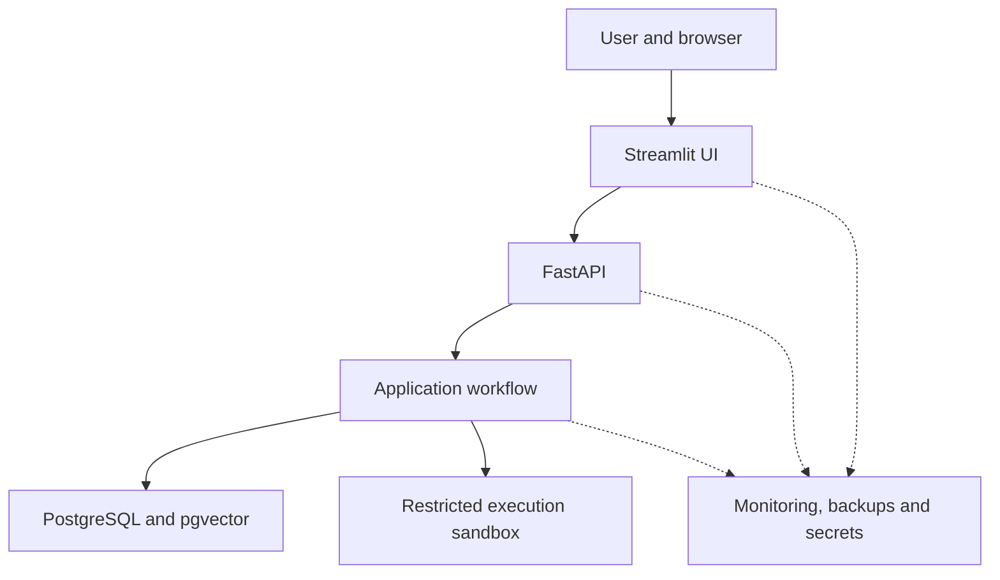
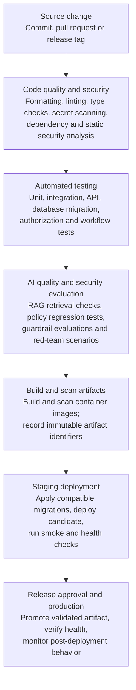

## Design Principles
The deployment and Continuous Integration/Continuous Delivery (CI/CD) architecture must support repeatable builds, controlled releases, secure configuration, reliable operation and recovery from deployment failures.

The design follows these principles:
1. Reproducible environments: Development, testing and production must use consistent application packaging and explicitly defined dependencies.
2. Containerized deployment: Package the application and its supporting services using container images to reduce environment-specific differences.
3. Modular monolith: Deploy the API, UI and workflow components as a small number of clearly defined application components without introducing microservices prematurely.
4. Automated quality gates: Run tests, static analysis, dependency checks, security scans and evaluation suites before releasing a new version.
5. Immutable release artifacts: Build an application image once, identify it by its digest, and promote the same artifact through the deployment environments.
6. Controlled configuration: Separate environment-specific configuration and secrets from application code and container images.
7. Safe database evolution: Apply version-controlled migrations with explicit compatibility and recovery considerations.
8. Observable deployments: Expose health checks, deployment metadata, logs, metrics and traces to support operational diagnosis.
9. Recoverable releases: Maintain a documented rollback or roll-forward procedure for application, configuration and database failures.
10. Open-source-first tooling: Use free and open-source software for the core development, testing, packaging, deployment and observability toolchain.

## Deployment Architecture
The initial deployment should use Docker and Docker Compose. This provides a reproducible local environment and a practical deployment option for a single host, without requiring a Kubernetes cluster.

The logical deployment consists of the following components:

The UI supports assessment creation, status, findings, evidence review and reports. The API handles authentication, validation, authorization and workflow entry points. The workflow includes LangGraph, policy and evaluation components; it uses the data services and restricted execution sandbox. Operational services provide metrics, logs, traces, backups, secrets and deployment health checks.

This diagram represents logical responsibilities. It does not require every box to be a separate container.

### Initial container boundaries

For the first deployable version, use the following container boundaries:

| Container or service | Responsibility |
| --- | --- |
| `ui` | Runs Streamlit and communicates with FastAPI through the defined API contract. |
| `api` | Runs FastAPI and hosts the application modules and LangGraph workflow. |
| `db` | Runs PostgreSQL with the pgvector extension enabled. |
| `sandbox-runner` | Provides the isolated execution environment for untrusted test applications. |
| `prometheus` | Collects operational metrics. |
| `grafana` | Displays dashboards and operational trends. |

The observability containers can be introduced after basic application instrumentation is in place. A separate sandbox runner is a security boundary, not merely a performance optimization.

The database should use persistent storage, and its data directory must not be coupled to the lifecycle of the application container. Recreating the API or UI container must not delete assessment history or regulatory knowledge.

The API and UI may be deployed independently even though the core workflow remains in a single modular application. This makes it possible to update the interface without duplicating the policy engine or workflow logic.

### Environment Strategy
The project should use distinct environments with explicit promotion criteria.

| Environment | Purpose | Data and configuration |
| --- | --- | --- |
| Development | Implement modules and debug workflows. | Synthetic data, local services and development credentials. |
| Test / CI | Run automated tests and validate candidate builds. | Ephemeral or isolated test databases and controlled fixtures. |
| Staging | Validate the release candidate under production-like conditions. | Sanitized data, staging credentials and representative configurations. |
| Production | Run authorized assessments and retain operational records. | Protected persistent data, production secrets, backups and restricted access. |

For a portfolio deployment, staging and production may initially share one host or use a single-host staging environment followed by a production deployment. The environments must nevertheless have separate configuration and data boundaries.

Production assessment records must never be copied into development or CI environments without an explicitly approved and appropriately sanitized process.

Environment configuration should define the database connection, API endpoints, model provider settings, timeouts, retry limits, logging levels and resource limits. Environment-specific values must not be hard-coded into Python modules or Docker images.

## Containerization and Dependency Management
Each application container should have a reproducible build process.

The implementation should:
- Use explicit base-image versions and pin Python dependencies.
- Maintain a dependency lock file with resolved versions and integrity hashes where supported.
- Prefer minimal base images and install only required system packages.
- Run application processes as non-root users where practical.
- Avoid embedding credentials, evidence files or runtime state into images.
- Use .dockerignore to exclude virtual environments, caches, local databases, secrets and unnecessary development artifacts.
- Define health checks and reasonable resource limits.
- Configure graceful shutdown and request timeouts.
- Record the source commit, build identifier and image digest.
- Scan images and dependencies for known vulnerabilities.

Each application container should have a reproducible build process.
The implementation should:
- Use explicit base-image versions and pin Python dependencies.
- Maintain a dependency lock file with resolved versions and integrity hashes where supported.
- Prefer minimal base images and install only required system packages.
- Run application processes as non-root users where practical.
- Avoid embedding credentials, evidence files or runtime state into images.
- Use .dockerignore to exclude virtual environments, caches, local databases, secrets and unnecessary development artifacts.
- Define health checks and reasonable resource limits.
- Configure graceful shutdown and request timeouts.
- Record the source commit, build identifier and image digest.
- Scan images and dependencies for known vulnerabilities.
A pinned dependency set improves repeatability, but it does not guarantee that a build will remain secure indefinitely. Dependencies must be updated through controlled maintenance and vulnerability review.

The ui container should contain only the UI dependencies, while the api container contains the API, workflow, policy and retrieval dependencies. Shared domain contracts should be maintained in the project codebase without duplicating business logic across the UI and API.

The sandbox runner should have a separate image and a more restrictive security configuration than the ordinary application containers.

## CI/CD Pipeline
The CI/CD pipeline automates validation and release preparation. A code change should not be considered deployable simply because the application starts successfully.

The pipeline should be implemented using an open-source CI system, such as Jenkins. A self-hosted Jenkins instance provides an open-source option for pipeline orchestration and can run on a local machine or dedicated host. A GitHub-hosted repository can still be used for source control, while the build and release workflow runs on the self-hosted CI infrastructure.

The pipeline should follow this sequence:
The pipeline should be implemented using an open-source CI system, such as Jenkins. A self-hosted Jenkins instance provides an open-source option for pipeline orchestration and can run on a local machine or dedicated host. A GitHub-hosted repository can still be used for source control, while the build and release workflow runs on the self-hosted CI infrastructure.
The pipeline should follow this sequence:

### Quality gates

Each stage must have an explicit pass or fail criterion.
Gate	Minimum requirement
| Gate | Minimum requirement |
| --- | --- |
| Code quality | Formatting, linting and configured type checks pass. |
| Unit tests | Required tests for policy rules, validation and domain logic pass. |
| Integration tests | API, PostgreSQL, pgvector and workflow integration tests pass. |
| Security tests | Mandatory authorization, secret and vulnerability checks pass. |
| AI evaluations | Required policy, retrieval and guardrail regression thresholds are met. |
| Build validation | Application and sandbox images build successfully. |
| Deployment validation | Health checks, migrations and smoke tests succeed. |
| Release authorization | The deployment meets the approval policy for the target environment. |

Some expensive red-team tests can run in a scheduled pipeline or before a release rather than on every commit. However, critical policy regressions and mandatory security tests must block the affected release.

Evaluation results should be retained with the commit, dataset version, model configuration and pipeline run identifier. This makes it possible to explain why a release passed or failed.

## Testing Strategy Across the Delivery Lifecycle

The test strategy must cover traditional software correctness as well as AI-specific behavior.

### Unit tests
Test deterministic rules, applicability conditions, input validation, evidence handling, status transitions and report formatting without depending on external model providers.

### Integration tests
Verify that FastAPI, PostgreSQL, pgvector, migrations and workflow components interact correctly. Use isolated test databases and known fixtures.

### Workflow tests
Exercise LangGraph conditional paths, bounded retries, human-review transitions, failure recovery, completeness gates and execution limits.

### AI evaluation tests
Evaluate retrieval quality, citation validity, unsupported claims, policy classification, guardrail behavior and reproducibility metadata against versioned datasets.

### Red-team tests
Test prompt injection, malicious documents, unsafe tool requests, retrieval poisoning, attempts to bypass deterministic policy gates and attempts to escape execution restrictions.

### End-to-end tests
Create an assessment through the API, execute the workflow, persist findings, retrieve the report and verify that the results can be traced to the correct evidence and versions.

The test suite should include negative cases. For example, an assessment with missing mandatory evidence must not receive a successful outcome merely because the LLM produces a confident explanation.

Tests that require external LLMs should support a controlled evaluation mode with recorded fixtures or deterministic test doubles. Live-provider tests should be separate so that provider outages, rate limits or changing model behavior do not make every ordinary CI run unreliable.

## Database Migrations and Regulatory Knowledge Updates
Database schema changes and regulatory corpus updates must follow controlled processes.

### Database migrations
Use a version-controlled migration tool such as Alembic to manage PostgreSQL schema changes.

The migration process must:
1. Apply migrations in a defined order.
2. Validate constraints and indexes.
3. Test upgrades against a clean database and a representative existing schema.
4. Preserve existing assessment records.
5. Detect incompatible changes before production deployment.
6. Document recovery or roll-forward steps for failed migrations.

For changes that cannot be safely applied in a single step, use an expand-and-contract strategy:
- Add the new schema elements while retaining compatibility with the existing application.
- Deploy application code that supports the transition.
- Migrate or backfill existing data.
- Verify the new behavior.
- Remove obsolete schema elements in a later release.

A container rollback does not reverse a database migration automatically. Database recovery must be handled as a separate operation with a tested procedure.

### Regulatory knowledge updates
Regulatory source ingestion must be separated from ordinary application deployment.

A knowledge update should be processed through the ingestion, normalization, versioning, embedding and validation pipeline defined in Section 6. The new index must pass integrity and retrieval-quality checks before it is published for new assessments.

If an update fails validation, the currently approved index should remain available. Previously completed assessments must retain their original corpus and rule-set references.

This distinction prevents a document refresh or embedding-model change from silently changing the historical basis of an assessment.

## Release, Rollback and Recovery
The deployment strategy must minimize downtime and preserve assessment integrity when a release fails.

For the initial single-host deployment, a controlled recreate or rolling replacement of application containers may be sufficient. More advanced deployment strategies can be introduced if availability requirements justify them.

The release procedure should include:
- Build and validate the candidate artifact.
- Record the source commit and artifact digest.
- Verify configuration and secret availability.
- Confirm database backup status and migration compatibility.
- Apply compatible migrations.
- Deploy the candidate application.
- Run readiness checks and representative smoke tests.
- Confirm API, database, retrieval and workflow health.
- Monitor error rates and assessment outcomes after deployment.
- Retain the previous known-good image and configuration for recovery.

### Recovery scenarios

| Failure | Recovery approach |
| --- | --- |
| API or UI startup failure | Restore the previous known-good application image and configuration. |
| Failed database migration | Follow the documented migration recovery plan, using roll-forward or restoration as appropriate. |
| Corrupted or incomplete regulatory index | Keep the previous validated index active and rebuild or republish the failed version. |
| LLM provider outage | Apply bounded retries and backoff, then fail safely or defer the affected assessment. |
| Sandbox execution failure | Terminate the isolated job, preserve safe diagnostic metadata and retry only when appropriate. |
| Invalid policy or prompt release | Restore the previous version and rerun the relevant regression suite. |
| Data loss or database corruption | Restore from verified backups and reconcile any required recovery steps. |

A successful application rollback does not guarantee that data written by the failed release can be reversed. The recovery plan must account for partially completed assessments, external model calls, audit events and artifacts already produced.

### Backup and disaster recovery
PostgreSQL backups should include the structured records and the information necessary to reconstruct the database environment. The recovery procedure must account for the pgvector extension, schema migrations, regulatory corpus versions and persistent evidence artifacts.

At minimum:
- Schedule regular backups.
- Protect backups with access controls and encryption.
- Keep backup copies separate from the primary database failure domain.
- Define retention periods.
- Test restoration into a clean environment.
- Verify database integrity and evidence references after restoration.
- Document the acceptable data-loss window and recovery-time target.

The project should not claim a recovery-time objective or recovery-point objective until it has defined and tested them.

## Configuration, Secrets and Supply Chain Security

Deployment configuration must be external to application code and versioned where safe.

The repository should include:
- A documented example environment file containing placeholders only.
- Explicit configuration validation at startup.
- Separate configuration for development, testing, staging and production.
- A documented secrets-management mechanism.
- Dependency lock files.
- Version-controlled container build definitions.
- CI pipeline definitions.
- Database migration scripts.
- Health-check and deployment scripts.
- A documented release and recovery procedure.

Secrets must not be stored in Git, container images, logs, test fixtures or generated reports. Production credentials must be provided through an approved secrets mechanism and granted only to the components that need them.

Supply chain security should include dependency vulnerability scanning, container image scanning, secret scanning and review of new dependencies. Where practical, release artifacts should have recorded provenance and cryptographic digests.

The sandbox runner must not inherit API credentials or database credentials simply because it runs on the same host. Its permissions and access to networks and files must be explicitly restricted.

## Scalability and Production Evolution
The initial deployment should remain simple, but the architecture must allow capacity to grow without rewriting core business logic.

Potential scaling paths include:
- Running multiple API instances behind a reverse proxy or load balancer.
- Separating long-running assessment execution into managed workers.
- Introducing a durable task queue when asynchronous processing and backpressure require it.
- Scaling PostgreSQL and optimizing vector indexes based on measured workload.
- Moving evidence artifacts to a controlled object-storage service.
- Separating sandbox execution onto dedicated hosts or stronger isolation infrastructure.
- Introducing centralized telemetry collection and externalized secrets management.
- Moving to an orchestrated container platform if availability, deployment or scaling requirements justify the added operational complexity.

LangGraph workflow definitions, policy interfaces, evidence contracts and retrieval interfaces should remain independent of deployment-specific mechanics. This preserves the modular monolith while making future extraction possible.

Scaling must also respect concurrency controls. Increasing API replicas must not bypass limits on simultaneous red-team executions, model-provider requests, database connections or resource-intensive assessments.

The initial design does not require Kubernetes, a distributed message broker or a separate vector database. Each should be introduced only when measured workload, reliability requirements or operational constraints justify it.

## Deployment Acceptance Criteria
The project should be considered deployable only when the following acceptance criteria have been demonstrated:

- The complete application starts from documented configuration using the defined container deployment process.
- The Streamlit UI communicates with FastAPI through the documented API contract.
- PostgreSQL and pgvector initialize correctly, and database migrations can be applied to a clean environment.
- A representative assessment can execute successfully and persist traceable findings.
- An assessment with insufficient evidence is not incorrectly reported as successful.
- Untrusted test applications execute only inside the restricted sandbox.
- Authentication and authorization checks prevent unauthorized access to assessments and evidence.
- Logs, metrics and traces provide enough information to diagnose a failed assessment.
- Regulatory documents, policy rules and assessment runs retain the required version references.
- CI/CD runs the mandatory tests and security checks before a release.
- The previous known-good application version can be restored using the documented recovery procedure.
- Database and evidence backups can be restored and validated.
- The release process records the source commit, artifact identity and evaluation results.

These criteria provide measurable evidence that the system is more than a demonstration application. They do not, by themselves, establish that the sandbox or any assessed AI system is legally compliant.

----------------------------------------------------

## Key Features

The platform is designed to support the following capabilities:

1. Risk classification - Assess AI systems against relevant risk categories, including prohibited practices and high risk categories.
2. Regulatory control evaluation - Evaluate applicable requirements associated with the below articles:
    - Article 5 - outlaws 8 categories of AI Usage such as
        - Subliminal manipulation - AI that uses hidden techniques outside a person's conscious awareness to alter their behavior.
        - Vulnerability exploitation - AI that exploits a person’s age, disability, or specific social/economic situation to distort their behavior and cause harm.
        - Social scoring systems - AI used by governments or private companies to grade people based on their daily social behavior, leading to unfair or unrelated penalties.
        - Biometric categorization to infer sensitive personal traits - AI that analyzes physical characteristics to deduce protected personal traits like race, religion, or sexual orientation.
        - Real-Time Public Biometric Identification -  Using live facial recognition in public spaces for law enforcement tracking.
        - Emotion Recognition in Workplace and Schools - AI that attempts to detect a person's emotional state in professional or educational environments.
        - Untargeted Facial Scraping - Creating or expanding facial recognition databases by mass-harvesting images from the internet or CCTV footage.
        - Predictive Policing for Individuals - AI that predicts whether a specific individual will commit a crime based purely on profiling or past behavior, without hard evidence.
        - Non-Consensual Deepfake Intimate Images - AI used to create, modify, or distribute sexually explicit images or videos of a person without their consent.
        - AI-Generated Child Abuse Material - AI used to generate, facilitate, or expand the reach of child sexual abuse material.
    - Article 6 - lists classification rules to group them into a high risk category if any app has these:
        - Regulated Product Safety - AI systems built into physical products that already require independent, third-party safety certifications under existing EU laws.
        - Standalone High-Risk Software 
            - Biometrics (Allowed Uses) - AI used for legal remote biometric identification, emotion recognition, or scanning traits (that aren't already banned under Article 5).
            - Critical Infrastructure - AI used to manage or operate vital safety systems for public utilities and transport.
            - Education and Vocational Training - AI used to determine access to school, rank students, or monitor them during exams.
            - Employment and Worker Management - AI used for recruiting, filtering applications, or monitoring and evaluating employees.
            - Essential Private and Public Services - AI used to evaluate if people qualify for life-changing financial or social benefits.
            - Law Enforcement (Allowed Uses) - AI tools used by police to assess evidence, evaluate polygraphs, or calculate recidivism risks.
            - Migration, Asylum, and Border Control - AI used to assist authorities in checking travel documents or assessing security risks of travelers.
            - Administration of Justice and Democracy - AI used by courts to research laws or systems intended to influence the outcome of an election.
    - Article 50 - this article looks at transparency rules. It specifies that all people have a right to know when they are dealing with AI and AI related content, and they should have the sole right to choose to use it or not. Rules are split between providers and deployers/AI users.
        - For providers: 
            - Disclosing Direct AI Interactions (Chatbots) which means, AI systems designed to talk to humans must explicitly warn the user that they are interacting with a machine, unless it is totally obvious to the user it is talking to a bot.
            - Watermarking and Content Tracking (Synthetic Media) which means, AI systems generating synthetic content should have an invisible, reliable, machine readable markings directly into their outputs so that the user is aware it is dealing with synthetic media.
        - For AI Users:
            - Labeling Deepfakes which means that if a business alters or generates realistic audio, video and image content that mimics real people, events or places, the content must be specifically labelled. An exception can be made if content is created for strictly artistic, creative, or satirical purposes, provided a basic, non-obtrusive disclosure is made.
            - Notifying People About Emotion and Biometric Tracking -  If a system uses allowed biometrics to categorize people or scan their emotions, the people exposed to it must be actively informed.
            - Labeling Public-Interest AI Text - If AI generates or heavily modifies news articles or public reports meant to inform the public on matters of general interest, it must be disclosed.
    - Article 51- General Purpose AI(GPAI) models need to comply with the below:
        - Systemic Risk Classification - Any AI model trained on a massive computational scale is automatically considered to have systemic risk.
        - The Notification Procedure - AI Builders need to step forward and alert the EU Commision if their model meets the high impact criteria.
        - Baseline Obligations for ALL GPAI Models - Any model which has been identified has systemic risk, will require the below to be done:
            - Maintain detailed report of training and testing data for the EU office
            - Provide clear instructions and documentation to any consumer using this model to build AI tools on top of this model.
            - Create a strict policy to honour EU copyright laws and respect creator data outputs.
            - Publish a clear public overview of the text, data, or media used to train the model
    - Article 54 -  If an AI provider is based outside the EU (such as in the US or Asia) but wants to make its model available to European users, it must legally appoint an Authorized Representative located within the EU to handle compliance requests and potential liability.
    - Article 55 - Extra Obligations for Systemic Risk Models
            -  Force continuous, aggressive hacking and stress-testing of the model to uncover hidden flaws.
            - Assess and continuously patch potential national security, economic, or societal risks.
            - Immediately alert the EU office if the model has caused a severe accident or malfunctioned.
            - Implement top tier digital security to lock down and protect the model's weights and architecture from data leaks or foreign thefts.
3. Evidence-backed assessments - Retrieve relevant regulatory provisions and link evaluation findings to their supporting evidence.
4. AI safety and guardrails - Test AI applications for policy violations, unsafe outputs, prompt injection, and other identified risks.
5. Automated evaluation and red teaming - Execute repeatable test suites to measure application behavior, robustness, and compliance-related control effectiveness.
6. Auditability and reproducibility- Record evaluation inputs, configuration versions, findings, evidence references, and decisions to support traceability and repeatable assessments.
7. Operational observability- Monitor evaluation performance, errors, guardrail violations, and other operational metrics.
8. Continuous integration- Integrate automated checks into development and deployment workflows to identify issues before release.